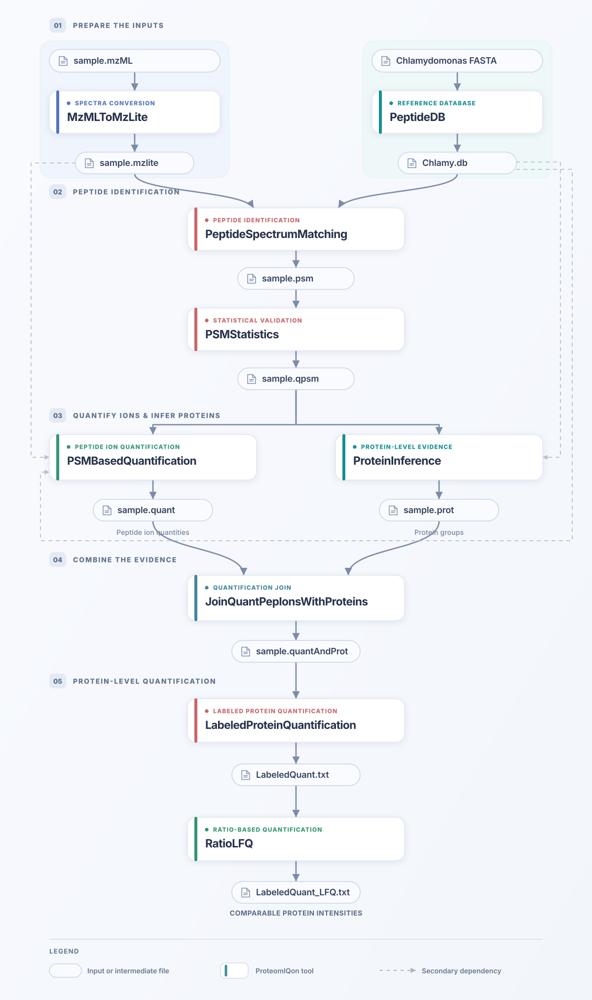
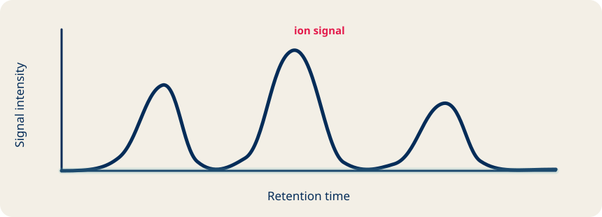

**Level:** Beginner  

**Core tools:** [MzMLToMzLite](../tools/mzml-to-mzlite.md) · [PeptideDB](../tools/peptide-db.md) · [PeptideSpectrumMatching](../tools/peptide-spectrum-matching.md) · [PSMStatistics](../tools/psm-statistics.md) · [PSMBasedQuantification](../tools/psm-based-quantification.md) · [ProteinInference](../tools/protein-inference.md) · [LabeledProteinQuantification](../tools/labeled-protein-quantification.md) · [RatioLFQ](../tools/ratio-lfq.md) 

**Optional preparation:** ProteoWizard MSConvert

## What will you learn?

Mass spectrometry provides detailed measurements of ions detected in a biological sample. However, a mass spectrum does not directly reveal which peptide produced a signal, how abundant that peptide was, or which protein it originated from. These questions are addressed through computational analysis and trying to be resolved by ProteomIQon.

[ProteomIQon](https://csbiology.github.io/ProteomIQon/) provides a series of tools that transform mass spectrometry data into interpretable peptide and protein results. This tutorial introduces the **core steps of a computational analysis of a DDA workflow**, explains how the individual tools are connected, and shows how to interpret their principal output files.

By the end of this guide, you should be able to:

- Describe the main stages of a ProteomIQon analysis and explain why each stage is needed.
- Distinguish measured spectra from theoretical peptide information.
- Explain how peptide spectrum matches are generated and assessed for confidence.
- Describe how identified peptide ions are quantified from MS1 chromatographic signals.
- Understand why protein inference reports protein groups rather than necessarily unique proteins.
- Understand why mapping proteins to peptides is important.
- Why RatioLFQ is a crucial step for obtaining significant results
- Recognize the main ProteomIQon output files and the information they contain.
- Explain how these outputs can be used to investigate changes in protein abundance in response to iron deficiency.

---

## 1. What is ProteomIQon?

ProteomIQon is an open-source collection of command-line tools for the analysis of mass-spectrometry-based proteomics data. Rather than combining every analysis step in a single application, ProteomIQon divides the workflow into specialized tools. Each tool processes defined inputs and produces an output that can be used by another tool.

This modular structure allows different parts of a proteomics analysis to be examined independently. For example, peptide identification can be evaluated before peptide ion quantities are calculated. It also makes the relationship between processing steps and their results more transparent.

In this tutorial, we focus on nine tools:

| Tool | Main purpose |
| --- | --- |
| **MzMLToMzLite** | Prepares measured mass spectra for efficient downstream processing aswell as an easy acces to the ms-data. |
| **PeptideDB** | Generates a theoretical peptide database from a reference proteome. |
| **PeptideSpectrumMatching** (PSM) | Matches measured MS/MS spectra to candidate peptide sequences. |
| **PSMStatistics** | Evaluates the confidence of peptide–spectrum matches. |
| **PSMBasedQuantification** | Estimates the abundance of identified peptide ions. |
| **ProteinInference** | Determines which proteins or protein groups are supported by the identified peptides. |
| **JoinQuantPepIonsWithProteins** | Combines the Peptide Quantification and the Protein Identification, to analyse with Protein belongs to which identified peptide sequence |
| **LabeledProteinQuantification** | LabeledProteinQuantification combines the light and heavy peptide intensities and calculates a light-to-heavy ratio for each protein group and run.|
| **RatioLFQ** | A labeled experiment gives one light-to-heavy ratio per protein and run. RatioLFQ uses the shared heavy reference to convert these ratios into one comparable intensity per protein and run. |

### How the tools are connected

The workflow begins with **two different sources of information**: experimentally measured spectra and a reference proteome. These are prepared independently before they are combined for peptide identification.

Throughout the tutorial, we will follow one biological question: how does limited iron availability affect the protein abundance of *Chlamydomonas reinhardtii*? Each tool provides a different part of the evidence needed to address this question, from identifying peptides to comparing protein-level quantities.

Two distinctions are important from the beginning:

**Identification is not quantification.** Identification assigns a likely amino acid sequence to an MS/MS spectrum. Quantification estimates the measured abundance of a particular peptide ion.

**Peptide identification is not automatically unique protein identification.** A peptide sequence may occur in several proteins or isoforms. Protein inference takes this ambiguity into account.

### Knowledge check 1: Understanding the workflow

**Question:** Why does ProteomIQon use both a mass spectrometry file and a protein sequence database?

Show explanation

The mass spectrometry file contains experimentally observed signals. The protein sequence database provides theoretical peptide candidates that may explain those signals. Peptide identification requires a comparison between the two.

---

## 2. Example dataset and experimental context

 Imagine you are in the lab investigating how the green alga *Chlamydomonas reinhardtii* responds to iron deficiency. You suspect that limited iron availability affects the abundance of proteins involved in photosynthesis and cellular metabolism. To investigate this hypothesis, you establish two experimental conditions: an iron-replete control and an iron-deficient condition. But how can you measure changes in protein abundance between these conditions? One approach is to combine mass spectrometry-based proteomics with metabolic labeling. For this purpose, cells are grown in media containing different nitrogen isotopes: the naturally abundant light isotope 14N or the heavier stable isotope 15N. During growth, nitrogen is incorporated into amino acids and subsequently into proteins. As a result, peptides originating from the two conditions differ in mass while retaining the same amino acid sequence. Each replacement of a 14N atom with a 15N atom introduces a mass increase of approximately 0.997 Da. The total mass shift therefore depends on the number of nitrogen atoms within a peptide. After combining and processing the samples, the resulting peptides are analyzed by liquid chromatography coupled to tandem mass spectrometry (LC-MS/MS). Their mass differences allow the corresponding light and heavy peptide signals to be distinguished, while their signal intensities provide information about their relative abundances. However, the resulting mass spectrometry data do not directly provide protein identities or protein abundance ratios. These must be determined through computational data analysis. (Höhner R, et al,  The metabolic status drives acclimation of iron deficiency responses in *Chlamydomonas reinhardtii* as revealed by proteomics based hierarchical clustering and reverse genetics.) This is where **ProteomIQon** comes into play.

A prepared dataset containing both input data and example ProteomIQon results is available on [Zenodo](https://zenodo.org/records/22918096). The more comprehensive experimental project containing the underlying data used in this tutorial is described in the [RatioLFQ repository on PlantDataHub](https://git.nfdi4plants.org/caroott/RatioLFQ).

The two starting files represent the two sides of the analysis:

| Example file | Contains | Role in the workflow |
| --- | --- | --- |
| `sample.mzML` | Measured MS1 and MS/MS spectra, together with acquisition metadata | Experimental evidence |
| `Chlamy_JGI5_5Cp_Mp_gen.fasta` | Amino acid sequences of reference proteins | Basis for theoretical peptide candidates |

The following sections also refer to example intermediate files such as `sample.psm`, `sample.qpsm`, `sample.quant`, and `sample.prot`. These filenames illustrate the flow of information; they are not tasks that readers must complete.

### A brief reminder: DDA and LC–MS/MS

In liquid chromatography–tandem mass spectrometry (LC–MS/MS), peptides are separated over time by liquid chromatography and then measured by the mass spectrometer. During **data-dependent acquisition (DDA)**, the instrument typically records an **MS1 spectrum** and selects precursor ions for fragmentation. The resulting **MS2 spectra** (also called **MS/MS spectra**) contain fragment ions that provide evidence about the peptide sequence.

The two spectrum types therefore answer different questions:

- **MS1:** Which ion signals are observed at a given retention time, and how intense are they?
- **MS2:** Which fragments arise from a selected precursor ion, and which peptide sequence could produce them?

Both types of information are important. MS/MS spectra primarily support peptide identification, whereas the MS1 signal is central to the peptide ion quantification presented later in this guide.

In our biological example, MS2 evidence helps identify peptides from proteins involved in photosynthesis or cellular metabolism. MS1 measurements then allow us to compare the corresponding light and heavy peptide signals. Neither measurement alone tells us whether a protein responds to iron deficiency.

This picture shows a Total Ion Chromatogram (TIC), which gives information about all detected signals in one complete run. On the x-axis you see the Retention Time (RT) and on the y-axis you see the total signal of all detected ions in a given scan, normalized to the strongest total signal(Steven R. Shuken, An Introduction to Mass Spectrometry-Based Proteomics).

---

## 3. Preparing mass spectrometry data: MSConvert and MzMLToMzLite

### 3.1 From instrument-specific files to mzML

Mass spectrometers may store their data in manufacturer-specific formats, such as `.raw` or `.wiff`. Because these formats differ between instruments, computational workflows commonly use **mzML**, an open format for mass spectrometry data.

[ProteoWizard MSConvert](https://proteowizard.sourceforge.io/tools/msconvert.html) can convert many supported vendor formats into mzML. Depending on the instrument and the original data, conversion may also involve **peak picking** (or *centroiding*), which represents a measured peak using a mass-to-charge ratio and an intensity rather than a complete profile of many data points.

MSConvert is not a ProteomIQon analysis tool, but it can prepare the input format required at the beginning of the workflow. **For the example used here, this conversion is already complete:** the dataset contains `sample.mzML`.

### 3.2 Why convert mzML to mzLite?

The first core ProteomIQon tool is [MzMLToMzLite](https://csbiology.github.io/ProteomIQon/tools/MzMLToMzLite.html).

An mzML file contains spectra and their associated metadata. ProteomIQon converts these data into **mzLite**, a SQLite-based storage format designed to provide efficient access to individual spectra an its metadata. This matters because later tools repeatedly examine selected scans rather than simply reading the full dataset once.

The conversion retains the relevant MS1 and MS2 information in a form that can be accessed efficiently. Depending on the parameters, MzMLToMzLite can also restrict the retention-time range or apply peak picking. The correct choice depends on the state of the input data and the experimental setup.

| Aspect | In this example |
| --- | --- |
| **Input** | `sample.mzML` |
| **Tool** | MzMLToMzLite |
| **Output** | `sample.mzlite` |
| **Used later by** | PeptideSpectrumMatching and PSMBasedQuantification |

The `.mzlite` file is not intended as a human-readable table. Its main role is to store the measured spectra for later processing.

At this stage, we have not yet learned whether iron deficiency changes protein abundance. We have prepared the experimental evidence needed to identify peptides and measure their light and heavy signals in later steps.

### Knowledge check 2: What is stored in mzLite?

**Question:** Why is the `.mzlite` file useful for both identification and quantification, even though these processes address different questions?

Show explanation

The file contains experimental spectral data. PeptideSpectrumMatching uses measured precursor and MS/MS information to identify peptides. PSMBasedQuantification uses MS1 signals across retention time to estimate peptide ion abundance. Both processes depend on the same underlying measurements.

---

## 4. Creating the theoretical search space: PeptideDB

Measured fragmentation spectra cannot be interpreted without possible peptide sequences to compare them against. ProteomIQon therefore needs a **theoretical search space** derived from the reference proteome.

The [PeptideDB](https://csbiology.github.io/ProteomIQon/tools/PeptideDB.html) tool uses a proteome FASTA file to create a database of peptide sequences, peptide masses, modifications, and peptide-to-protein relationships. For our example, the  reference is a *C. reinhardtii* FASTA file, which contains the whole proteome.

### 4.1 In silico digestion

In a typical bottom-up proteomics experiment, proteins are digested into peptides before mass spectrometry analysis. A common enzyme is **trypsin**, which generally cleaves after lysine (K) or arginine (R), subject to sequence context.

PeptideDB represents this digestion computationally. This is known as **in silico digestion**. The tool determines which peptides could arise from the reference proteins under the specified digestion rules.

The theoretical search space does not necessarily contain only peptides that were actually present in the sample. Rather, it defines the candidates that the following search step is allowed to consider.

Although our hypothesis concerns photosynthesis and cellular metabolism, the reference proteome also contains proteins involved in other biological processes. Searching the broader proteome allows us to investigate responses beyond our initial hypothesis without restricting identification to proteins already expected to change.

### 4.2 Why database parameters matter

The generated peptide database depends on the experiment and on the parameters used to describe it.

| Parameter | Meaning | Effect on the analysis |
| --- | --- | --- |
| `Protease` | Enzyme used for theoretical digestion | Determines where protein sequences are cleaved. |
| `MinMissedCleavages` / `MaxMissedCleavages` | Permitted number of cleavage sites that were not cut | Broadens or restricts the theoretical peptide set. |
| `FixedMods` | Modifications assumed to occur at all specified sites | Changes the theoretical masses of affected peptides. |
| `VariableMods` | Modifications that may or may not be present | Adds possible modified forms to the search space. |
| `IsotopicMod` | Isotopic labels represented in the database | Determines whether labeled peptide variants are included. |
| `ParseProteinIDRegexPattern` | Rule for extracting protein identifiers from FASTA headers | Influences how peptides are linked back to reference proteins. |

For this example, the relevant digestion settings are **trypsin with zero to two missed cleavages**. The isotope modification list should be **15N**, because the example is a 15N-labeled search.

This is particularly important for our biological question: the same peptide sequence may occur in both light and heavy forms. Including the appropriate isotope variants allows the search to account for their different masses rather than treating the heavy form as an unrelated peptide.

*> **Important:** Default settings are not universally suitable. A peptide database should reflect the actual sample preparation and labeling strategy.*

Increasing the number of allowed missed cleavages, variable modifications, or isotope variants generally produces more theoretical candidates. This may increase computational effort and can affect the statistical difficulty of identifying peptides correctly.

| Aspect | In this example |
| --- | --- |
| **Input** | `Chlamy_JGI5_5Cp_Mp_gen.fasta` |
| **Tool** | PeptideDB |
| **Output** | `Chlamy.db` |
| **Used later by** | PeptideSpectrumMatching, PSMStatistics, PSMBasedQuantification, and ProteinInference |

The `.db` file is a SQLite database rather than a conventional text table.

### Knowledge check 3: Search-space design

**Question:** A laboratory sample was digested with trypsin, but the theoretical database was generated with a different protease. Why could this reduce identification performance?

Show explanation

The theoretical database would not accurately represent the peptides expected from the laboratory digestion. Some genuine peptide sequences might be absent, while additional irrelevant candidates could be included. As a result, measured spectra could be compared against an inappropriate search space.

**Question:** What is the likely consequence of increasing the maximum number of missed cleavages from two to five?

Show explanation

More incompletely cleaved peptide sequences become possible, increasing the number of theoretical peptide candidates. The larger search space can require more computation and may make statistical validation more challenging.

---

## 5. From measured fragments to peptide candidates: PeptideSpectrumMatching

Once the experimental spectra and the theoretical peptide database are available, ProteomIQon can compare them.

[PeptideSpectrumMatching](https://csbiology.github.io/ProteomIQon/tools/PeptideSpectrumMatching.html), commonly shortened to **PSM**, aims to determine which peptide candidates best explain the measured MS/MS spectra.

### 5.1 How does peptide–spectrum matching work?

The main idea is to compare **observed fragment ions** with **fragments expected from a theoretical peptide sequence**.

The analysis can be understood as five stages:

1. **Estimate the precursor charge.** Information from the precursor isotope pattern in the preceding MS1 spectrum helps determine its charge state.
2. **Determine the precursor mass.** The measured mass-to-charge ratio (`m/z`) and charge state are used to estimate the peptide mass.
3. **Find candidate peptides.** PeptideDB is searched for peptides whose theoretical masses fall within the permitted mass tolerance.
4. **Compare fragmentation patterns.** Expected fragment ions are calculated for each candidate and compared with the observed MS/MS spectrum.
5. **Score the candidates.** Numerical scores summarize how well each theoretical peptide explains the measured fragments.

The `LookUpPPM` parameter defines the precursor mass tolerance in parts per million (ppm). The documented default is **30 ppm**, meaning that candidates are retrieved within a defined relative mass window around the measured precursor mass.

ProteomIQon calculates several complementary search features, including **SEQUEST-like**, **Andromeda-like**, and **X!Tandem-like** scores. These scores describe different aspects of the agreement between theoretical and observed spectra.

Suppose a measured spectrum matches a peptide from a protein involved in photosynthesis. This is a first indication that the protein may be represented in the sample. However, the match does not yet establish whether the peptide was correctly identified or whether its abundance differs between the iron-replete and iron-deficient conditions.

### 5.2 Target and decoy peptides

Even a well-scoring candidate can be an incorrect identification. The search therefore includes **target** and **decoy** peptide candidates.

- **Target peptides** originate from the reference sequence search space.
- **Decoy peptides** are artificially generated sequences used to characterize matches expected to be incorrect.

For this search, decoys are generated by reversing peptide sequences while generally keeping the C-terminal residue in place. Comparing target and decoy results provides a basis for the statistical assessment performed in the next step.

### 5.3 What is a `.psm` file?

The output, `sample.psm`, is a tab-separated table containing peptide–spectrum match candidates and their search features. A row represents a candidate assigned to a measured spectrum. **At this stage, it is not yet a statistically accepted identification.**

Some useful columns are:

| Column | Interpretation |
| --- | --- |
| `PSMId`, `ScanNr` | Identifiers of the associated MS/MS spectrum. |
| `StringSequence` | Candidate peptide's amino acid sequence. |
| `Charge` | Estimated precursor ion charge state. |
| `PrecursorMZ` | Measured precursor mass-to-charge ratio. |
| `TheoMass`, `AbsDeltaMass` | Theoretical mass and deviation from the measured mass. |
| `Label` | Target (`1`) or decoy (`-1`) designation. |
| `SequestScore`, `AndroScore`, `XTandemScore` | Search scores describing spectral agreement. |
| `PepSequenceID`, `ModSequenceID` | Peptide database references for the sequence and its modified form. |
| Aspect | In this example |
| --- | --- |
| **Inputs** | `sample.mzlite` and `Chlamy.db` |
| **Tool** | PeptideSpectrumMatching |
| **Output** | `sample.psm` |
| **Used later by** | PSMStatistics |

### Knowledge check 4: Is the best match necessarily correct?

**Question:** A peptide candidate has the highest search score for an MS/MS spectrum. Is that sufficient evidence to call it a confident identification?

Show explanation

No. A high score means that a candidate explains the spectrum well according to a scoring method. It does not, by itself, quantify the expected rate of incorrect identifications. Statistical evaluation of target and decoy matches is still necessary.

---

## 6. Assessing identification confidence: PSMStatistics

[PSMStatistics](https://csbiology.github.io/ProteomIQon/tools/PSMStatistics.html) evaluates the candidate matches produced by PeptideSpectrumMatching. Its purpose is to distinguish likely correct identifications from unreliable matches and attach statistical confidence estimates to the retained results.

### 6.1 Why are additional statistics needed?

Different MS/MS spectra vary in quality, and no individual search score captures every aspect of a reliable match. PSMStatistics therefore combines several search features using a **semi-supervised machine-learning approach** trained to separate target and decoy candidates.

In simplified terms, the procedure begins with a set of high-confidence examples, learns a combined scoring model, evaluates candidates, and refines the model using updated confident matches. Its target–decoy framework provides the information needed to estimate identification errors.

The result is more informative than the original list of scored candidates.

### 6.2 Q-values and posterior error probabilities

Two measures are particularly important:

| Measure | What it describes | How to interpret it |
| --- | --- | --- |
| **Q-value** | Estimated false discovery rate (FDR) associated with accepting matches at a given score threshold | A Q-value of `0.01` corresponds to an estimated FDR of 1% for the accepted set at that threshold. |
| **PEP value** (posterior error probability) | Estimated probability that an individual peptide–spectrum match is incorrect | A smaller value indicates greater confidence in that individual match. |

For example, if an accepted group of identifications has an estimated FDR of 1%, this refers to the **expected proportion of false matches in the accepted group**, not to a claim that each match has exactly a 1% chance of being wrong.

PSMStatistics uses configurable thresholds to determine which target identifications are retained. The specific thresholds should be selected and reported consistently with the study's analysis goals.

### 6.3 From `.psm` to `.qpsm`

The main output is `sample.qpsm`, a tab-separated table of statistically evaluated and retained target PSMs. It contains identification information together with confidence-related columns.

| Column | Interpretation |
| --- | --- |
| `StringSequence` | Identified peptide sequence. |
| `ScanTime` | Retention time of the associated MS/MS identification. |
| `Charge`, `PrecursorMZ` | Properties of the identified ion. |
| `ModelScore` | Combined score from the statistical model. |
| `QValue` | Estimated Q-value for the match. |
| `PEPValue` | Estimated error probability for the individual match. |
| `ProteinNames` | Reference proteins associated with the peptide sequence. |
| Aspect | In this example |
| --- | --- |
| **Inputs** | `sample.psm` and `Chlamy.db` |
| **Tool** | PSMStatistics |
| **Output** | `sample.qpsm` |
| **Used later by** | PSMBasedQuantification and ProteinInference |

**The central difference:** `.psm` records search candidates and their scores; `.qpsm` records statistically evaluated target identifications that satisfy the selected confidence thresholds.

For our iron-deficiency example, this step reduces the risk of interpreting an incorrectly identified peptide as evidence for a biological response. A low q-value supports identification confidence, but does not establish that the abundance of the corresponding protein has changed.

### Knowledge check 5: Understanding error estimates

**Question:** Which measure is intended to describe the error probability of one individual PSM: its q-value or its PEP value?

Show explanation

The PEP value estimates the probability that an individual match is incorrect. The q-value relates to the estimated false discovery rate of a set of matches accepted at a particular score threshold.

**Question:** Why are decoy candidates useful, although they do not represent the peptides expected in the biological sample?

Show explanation

Decoys provide a reference distribution for incorrect matches. Their scores can be compared with target scores to help estimate false discoveries and to train or evaluate models that distinguish more reliable from less reliable identifications.

---

## 7. Estimating peptide ion abundance: PSMBasedQuantification

After statistical validation, ProteomIQon has evidence about **which peptides were identified**. The next question is how strong the corresponding signals were in the chromatographic run.

[PSMBasedQuantification](https://csbiology.github.io/ProteomIQon/tools/PSMBasedQuantification.html) uses confident PSMs to find and quantify peptide ion signals in the MS1 data.

### 7.1 What is being quantified?

A **peptide ion** is characterized by its peptide sequence, modification state, and charge state. The same amino acid sequence can therefore be represented by more than one peptide ion if its modification or charge differs.

This distinction matters because the instrument measures **ions**, and different ionic forms may produce different signals. The quantity reported at this stage is a peptide **ion** quantity rather than a protein-level abundance.

### 7.2 Extracted ion chromatograms (XICs)

As a peptide elutes from the chromatography column, its signal may appear in consecutive MS1 scans. These scans can be combined into an **extracted ion chromatogram (XIC)**: a trace showing ion intensity across retention time for a selected mass-to-charge interval.

PSMBasedQuantification uses the identified peptide ion's `m/z` and MS/MS retention-time information to locate the relevant signal. It detects chromatographic peaks and fits an appropriate peak in the expected region.

The **fitted chromatographic peak area** is reported as the peptide ion quantity.

<figure class="beginner-scientific-figure beginner-chromatogram-figure" aria-labelledby="chromatogram-title chromatogram-description">

<figcaption class="beginner-scientific-figure-caption">

<strong id="chromatogram-title">Schematic chromatographic peak</strong>

The fitted peak area represents peptide ion quantity; the apex marks maximum signal intensity.

</figcaption>

<svg viewBox="0 0 760 330" role="img" aria-labelledby="chromatogram-title chromatogram-description">

<defs>

<linearGradient id="chromatogram-area" x1="0" x2="0" y1="0" y2="1"><stop offset="0" stop-color="var(--teal)" stop-opacity=".42"></stop><stop offset="1" stop-color="var(--teal)" stop-opacity=".08"></stop></linearGradient>

</defs>

<line class="figure-axis" x1="76" y1="26" x2="76" y2="260"></line>

<line class="figure-axis" x1="76" y1="260" x2="710" y2="260"></line>

<path class="chromatogram-area" d="M110 260 C170 260 205 256 242 238 C290 214 305 91 366 67 C421 46 439 214 486 240 C531 264 597 260 679 260 L679 260 L110 260 Z"></path>

<path class="chromatogram-curve" d="M110 260 C170 260 205 256 242 238 C290 214 305 91 366 67 C421 46 439 214 486 240 C531 264 597 260 679 260"></path>

<line class="chromatogram-apex-guide" x1="366" y1="67" x2="366" y2="260"></line>

<circle class="chromatogram-apex" cx="366" cy="67" r="6"></circle>

<text class="figure-axis-label" x="28" y="145" transform="rotate(-90 28 145)" text-anchor="middle">Signal intensity</text>

<text class="figure-axis-label" x="393" y="300" text-anchor="middle">Retention time</text>

<text class="figure-annotation" x="424" y="100">peak apex</text>

<text class="figure-annotation" x="424" y="119">maximum signal</text>

<text class="figure-annotation" x="180" y="222">integrated peak area</text>

<text class="figure-annotation" x="180" y="241">peptide ion quantity</text>

</svg>

Schematic — illustrative shape only; values do not represent an experimental measurement.

</figure>

This quantity is based on the signal observed over a retention-time interval. It is different from the **peak apex**, which refers only to the intensity at the maximum of the chromatographic peak.

Returning to our iron-deficiency experiment, imagine that the light form of a peptide has a fitted peak area of 200,000 and its heavy counterpart has a fitted peak area of 100,000. The light-to-heavy ratio is 2. If light represents the iron-deficient sample and heavy the iron-replete control, this would suggest a higher relative abundance of that peptide in the iron-deficient condition, assuming comparable sample contributions and an appropriate normalization strategy. If heavy is a shared reference instead, the ratio must be compared with the corresponding ratio from the control run. These values are illustrative, not measurements from the tutorial dataset.

### 7.3 Parameters that influence quantification

Several settings determine which signal is extracted and how it is evaluated.

| Parameter | Purpose |
| --- | --- |
| `PerformLabeledQuantification` | Defines whether only unlabeled peptide ions or labeled partner ions are considered. |
| `XicExtraction.ScanTimeWindow` | Sets the retention-time region examined around identifications. |
| `XicExtraction.MzWindow_Da` | Defines the mass-to-charge window used to extract the chromatogram. |
| `XicExtraction.XicProcessing` | Controls chromatographic peak detection. |
| `CentrePSMs`, `RequirePeakAtScanTime` | Control how identification times guide selection of the chromatographic peak. |
| `BaseLineCorrection` | Controls optional background correction of the chromatographic signal. |

For our **15N-labeled example**, quantification must be configured for labeled peptide ions using `PerformLabeledQuantification`. The corresponding light and heavy signals are extracted and quantified. The experimental design determines whether these represent two directly compared conditions or a biological sample and a shared reference.

### 7.4 Interpreting the `.quant` file

The output table contains the peptide ion identity, information inherited from PSMStatistics, and measures describing the fitted signal.

| Column | Interpretation |
| --- | --- |
| `StringSequence`, `Charge` | Peptide sequence and charge state. |
| `QValue`, `PEPValue` | Confidence measures associated with identification. |
| `Quant_Light` | **Fitted peak-area quantity** of the unlabeled peptide ion. |
| `Quant_Heavy` | Fitted peak-area quantity of the heavy-labeled peptide ion. |
| `MeasuredApex_Light` | Intensity measured at the chromatographic peak maximum. |
| `QuantMZ_Light` | Mass-to-charge value associated with the extracted light ion signal. |
| `Params_Light` | Parameters describing the fitted peak. |
| `Difference_SearchRT_FittedRT_Light` | Difference between identification retention time and the fitted peak position. |
| `KLDiv_Observed_Theoretical_Light` | Diagnostic measure comparing observed and expected isotope patterns. |

A strong fitted signal does not necessarily mean an identification is reliable; that is why identification confidence is evaluated separately. Likewise, a quantified signal should not be interpreted as an absolute molecule count without appropriate calibration.

Large differences between the MS/MS identification time and the fitted peak location may indicate a feature that warrants closer examination. The tool can produce diagnostic chromatographic plots, which help assess whether the selected peak is plausible.

| Aspect | In this example |
| --- | --- |
| **Inputs** | `sample.mzlite`, `sample.qpsm`, and `Chlamy.db` |
| **Tool** | PSMBasedQuantification |
| **Output** | `sample.quant` |
| **Main result** | Peptide ion quantities, including `Quant_Light` and `Quant_Heavy` |

### Knowledge check 6: Peak area versus peak apex

**Question:** Which column represents the primary peptide ion quantity for the light peptide ion: `Quant_Light` or `MeasuredApex_Light`?

Show explanation

<code>Quant_Light</code> is the fitted chromatographic peak area and is the quantity reported by this step. <code>MeasuredApex_Light</code> records the peak's maximum intensity, which can be useful diagnostically but is not the fitted-area quantity.

**Question:** Why does PSMBasedQuantification require both the `.qpsm` and the `.mzlite` files?

Show explanation

The .qpsm file indicates which peptide ions were identified and provides their mass-to-charge and retention-time information. The .mzlite file provides the underlying measured MS1 signals from which chromatographic peaks and quantities are determined.

---

## 8. From identified peptides to proteins: ProteinInference

Proteins are usually identified indirectly through the peptides produced during digestion. However, a peptide sequence is not necessarily unique to one protein. Shared sequences are common among related proteins and different isoforms.

[ProteinInference](https://csbiology.github.io/ProteomIQon/tools/ProteinInference.html) addresses this problem by mapping confidently identified peptides to their possible parent proteins and reporting the protein groups supported by the evidence.

### 8.1 Why are protein groups necessary?

Consider two hypothetical proteins:

If only **peptide 2** is identified, there is not enough information to determine whether Protein A, Protein B, or both contributed to the sample. Assigning the peptide to one protein alone would overstate the evidence.

Protein inference represents such uncertainty through **protein groups**. The precise way overlapping evidence is integrated depends on the inference settings. The tool also estimates confidence at the protein-group level using target and decoy evidence.

This distinction is biologically relevant when interpreting the response to iron deficiency. For example, if two related photosynthetic proteins share a peptide, a change in that peptide's abundance cannot automatically be attributed to either protein individually. Protein-specific evidence is needed to support a more precise biological interpretation.

### 8.2 What information is in `.prot`?

The output, `sample.prot`, summarizes inferred groups and their supporting peptide evidence.

| Column | Interpretation |
| --- | --- |
| `ProteinGroup` | Protein identifiers associated with the inferred group. |
| `PeptideSequence` | Peptide sequences supporting the group. |
| `Class` | Classification of peptide evidence, informed by available gene or isoform annotation. |
| `TargetScore`, `DecoyScore` | Scores derived from target and decoy evidence. |
| `QValue` | Estimated protein-group-level q-value. |

ProteomIQon can use optional **GFF3 annotation** to provide information about which protein isoforms originate from the same gene. Without such annotation, protein grouping can still be performed, but the biological interpretation of the `Class` field is more limited.

| Aspect | In this example |
| --- | --- |
| **Inputs** | `sample.qpsm` and `Chlamy.db` |
| **Tool** | ProteinInference |
| **Output** | `sample.prot` |
| **Main result** | Inferred protein groups and their confidence |

Note that ProteinInference uses **peptide identification evidence**, not the quantitative peak areas from `.quant`. It determines which proteins are supported by the identified sequences. Estimating the abundance of these proteins is a separate downstream analysis.

### Knowledge check 7: Shared peptides

**Question:** If an identified peptide occurs in two protein isoforms, can that peptide alone establish which isoform was present?

Show explanation

No. The peptide is compatible with both isoforms. Additional evidence, such as peptides unique to one isoform, is needed to distinguish them. Protein groups preserve the uncertainty when the available peptide evidence does not support a unique assignment.

---

## 9. Bringing the results together

The central ProteomIQon output files represent **different levels of information**. Understanding these differences is essential when interpreting a proteomics analysis.

| File | Generated by | Main question answered |
| --- | --- | --- |
| `.mzlite` | MzMLToMzLite | What spectral signals were measured? |
| `.db` | PeptideDB | Which peptide sequences are theoretically possible? |
| `.psm` | PeptideSpectrumMatching | Which peptide candidates match each MS/MS spectrum, and how well? |
| `.qpsm` | PSMStatistics | Which PSMs pass the confidence criteria, and how reliable are they? |
| `.quant` | PSMBasedQuantification | What is the fitted chromatographic quantity of an identified peptide ion? |
| `.prot` | ProteinInference | Which protein groups are supported by the peptide evidence? |

These files should not be interpreted independently of their analytical context. For instance, the peptide database influences which sequences can be identified; the accepted identifications influence which ions are quantified; and the peptide-to-protein mappings influence the inferred protein groups.

A particularly important distinction concerns the **two final branches** of this workflow:

- The `.quant` file reports **peptide ion signal quantities**.
- The `.prot` file reports **protein group identities and confidence**.

Neither file on its own provides a final protein-level abundance estimate.

We can now identify supported protein groups and estimate the quantities of their peptide ions. To address our original hypothesis about iron deficiency, we still need to connect these two types of evidence and calculate protein-level quantities that can be compared between conditions.

### Knowledge check 8: Choose the correct result

Match each scientific question to the most appropriate file:

1. Which peptide candidates were originally considered for a measured MS/MS spectrum?
2. What is the q-value of an accepted peptide–spectrum match?
3. What fitted peak area was determined for an identified peptide ion?
4. Which proteins are grouped together based on shared peptide evidence?

Show answers

1. <code>.psm</code> &nbsp; 2. <code>.qpsm</code> &nbsp; 3. <code>.quant</code> &nbsp; 4. <code>.prot</code>

---

## 10. From peptide quantities to biological comparisons

The tools introduced above cover the core steps from measured spectra to peptide ion quantities and protein groups. We now extend these results to address our original biological question at the protein level. ProteomIQon also supports further analyses for more complex experimental designs.

### 10.1 Protein-level quantification

To calculate protein-level quantities, the peptide ion results must first be connected to the inferred protein groups:

1. [JoinQuantPepIonsWithProteins](https://csbiology.github.io/ProteomIQon/tools/JoinQuantPepIonsWithProteins.html) combines `.quant` and `.prot` information into a `.quantAndProt` file.
2. [LabeledProteinQuantification](https://csbiology.github.io/ProteomIQon/tools/LabeledProteinQuantification.html) uses the combined data to calculate light-to-heavy ratios for protein groups in labeled experiments.
3. [RatioLFQ](https://csbiology.github.io/ProteomIQon/tools/RatioLFQ.html) can be used when multiple runs contain a shared heavy reference, converting protein-level ratios into comparable relative intensities across runs. This step is specific to the shared-reference design and is not required for every labeled experiment.

For example, if both iron-replete and iron-deficient samples are measured against the same heavy reference, their light-to-heavy ratios can be related across runs. A ratio of 0.5 in the control and 1.0 under iron deficiency would indicate an estimated twofold increase relative to the control, assuming comparable normalization and reliable measurements. These numbers are hypothetical.

To determine whether this change reflects a reproducible biological response, protein-level results must be compared across biological replicates using an appropriate statistical analysis. Identification FDR is not a test of differential protein abundance.

### 10.2 Alignment across multiple LC–MS/MS runs

In a study with several runs, the same peptide may not be identified by MS/MS in every run even when a chromatographic signal is present. Additional alignment tools can relate signals across runs and improve the coverage of quantitative measurements.

For our biological example, this can help improve the completeness of peptide measurements across iron-replete and iron-deficient replicates. A missing identification in one run does not necessarily mean that the peptide or protein was absent from that biological condition.

Examples include [QuantBasedAlignment](https://csbiology.github.io/ProteomIQon/tools/QuantBasedAlignment.html), [AlignmentBasedQuantification](https://csbiology.github.io/ProteomIQon/tools/AlignmentBasedQuantification.html), and [AlignmentBasedQuantStatistics](https://csbiology.github.io/ProteomIQon/tools/AlignmentBasedQuantStatistics.html).

### 10.3 Label-free experiments and ion mobility

Our motivating example uses **15N labeling**. Alternatively, protein abundance can be compared between separately measured, unlabeled samples using label-free quantification. ProteomIQon supports this approach through [LabelFreeProteinQuantification](https://csbiology.github.io/ProteomIQon/tools/LabelFreeProteinQuantification.html).

For a 15N workflow, the peptide search space must include the appropriate isotope variants, and quantification must be configured to evaluate the corresponding light and heavy signals. These settings must agree with the experimental design; otherwise the identified and quantified species may not correspond to the actual sample.

ProteomIQon additionally provides tools for mass spectrometry experiments with ion mobility measurements, such as timsTOF-based workflows. The [official workflow overview](https://csbiology.github.io/ProteomIQon/) identifies the specialized tools used for these data.

---

## 11. Final self-assessment

The following questions revisit the main concepts of the tutorial. Consider each one before revealing the answer.

### Question 1 — Theoretical versus experimental information

**Which tool builds a theoretical peptide search space from a FASTA file?**

A. MzMLToMzLite  

B. PeptideDB  

C. PSMStatistics  

D. ProteinInference

Show answer

<strong>B — PeptideDB.</strong> It performs in silico protein digestion and stores theoretical peptide candidates and their relationships to reference proteins.

### Question 2 — Search scores and confidence

**True or false?** A high SEQUEST-like score is sufficient to demonstrate that an identification meets a specified false discovery rate.

Show answer

<strong>False.</strong> A search score assesses spectral agreement but does not by itself establish a controlled error rate. PSMStatistics uses target and decoy evidence to estimate identification confidence.

### Question 3 — Identification and abundance

**What is the main reason PSMBasedQuantification examines MS1 data?**

A. To determine the complete protein sequence  

B. To assign reference protein identifiers  

C. To estimate chromatographic signal areas for identified peptide ions  

D. To generate a theoretical peptide database

Show answer

<strong>C.</strong> Identifications indicate which peptide ion to look for. The MS1 chromatographic signal provides the information needed to estimate its abundance.

### Question 4 — Protein inference

**True or false?** Every confidently identified peptide uniquely identifies one protein.

Show answer

<strong>False.</strong> A peptide may be shared by several proteins or isoforms. ProteinInference represents ambiguity using protein groups when unique assignments are not supported by the evidence.

### Question 5 — Choosing the next analysis

**Which additional analysis is needed to obtain protein-level quantities after producing**_`.quant`_**and**_`.prot`_**files?**

Show answer

The peptide ion quantities need to be linked to their inferred protein groups using JoinQuantPepIonsWithProteins. A subsequent tool, such as LabeledProteinQuantification for our labeled example, then estimates protein-group ratios. RatioLFQ can relate these ratios across runs when a shared heavy reference is used.

### Question 6 — Returning to the biological hypothesis

**A protein group has a higher estimated abundance under iron deficiency than in the iron-replete control. Does this alone demonstrate a reproducible response to iron deficiency?**

Show answer

<strong>No.</strong> The estimated difference supports the hypothesis, but its reproducibility must be assessed across biological replicates with appropriate normalization and statistical analysis. The identity and biological function of the protein group also need to be considered before drawing conclusions about photosynthesis or cellular metabolism.

---

## 12. Conclusion

ProteomIQon connects several analytical tasks that are necessary to interpret proteomics mass spectrometry data. In the labeled DDA workflow introduced here, measured spectra are prepared in mzLite format, theoretical peptides are generated from reference protein sequences, and MS/MS spectra are matched to candidate peptide sequences. Statistical validation then evaluates the confidence of these matches.

The resulting identifications support two related but distinct analyses. **PSMBasedQuantification** estimates peptide ion abundance from fitted MS1 chromatographic peak areas, while **ProteinInference** determines which protein groups are supported by the identified peptides. Together, these results provide the foundation for further protein-level quantification and comparisons across samples.

By joining peptide quantities with protein groups and calculating protein-level ratios, we can return to our initial question: which proteins show changes in abundance under iron deficiency? Comparing these quantities across biological replicates and interpreting the functions of the affected proteins can help us assess whether photosynthesis and cellular metabolism are affected. The workflow provides the quantitative evidence for this analysis; it does not by itself establish a significant biological response or a causal mechanism.

The main principle is that each stage answers a different scientific question. Understanding how the inputs, outputs, and assumptions of these stages are connected makes it easier to interpret the results of a ProteomIQon analysis and to explore more advanced workflows.

## Further reading

- [ProteomIQon — official documentation and workflow overview](https://csbiology.github.io/ProteomIQon/)
- [ProteomIQon — source repository](https://github.com/CSBiology/ProteomIQon)
- [ProteomIQon example dataset and precomputed results](https://zenodo.org/records/22918096)
- [ProteoWizard MSConvert](https://proteowizard.sourceforge.io/tools/msconvert.html)
- [*Chlamydomonas reinhardtii* reference proteome (UniProt)](https://www.uniprot.org/proteomes/UP000006906)

## Literature

- Höhner R, Barth J, Magneschi L, Jaeger D, Niehues A, Bald T, Grossman A, Fufezan C, Hippler M. The metabolic status drives acclimation of iron deficiency responses in Chlamydomonas reinhardtii as revealed by proteomics based hierarchical clustering and reverse genetics. Mol Cell Proteomics. 2013 Oct;12(10):2774-90. doi: 10.1074/mcp.M113.029991. Epub 2013 Jul 2. PMID: 23820728; PMCID: PMC3790290.
- Steven R. Shuken; An Introduction to Mass Spectrometry-Based Proteomics. J. Proteome Res. 7 July 2023; 22 (7): 2151–2171. https://doi.org/10.1021/acs.jproteome.2c00838
