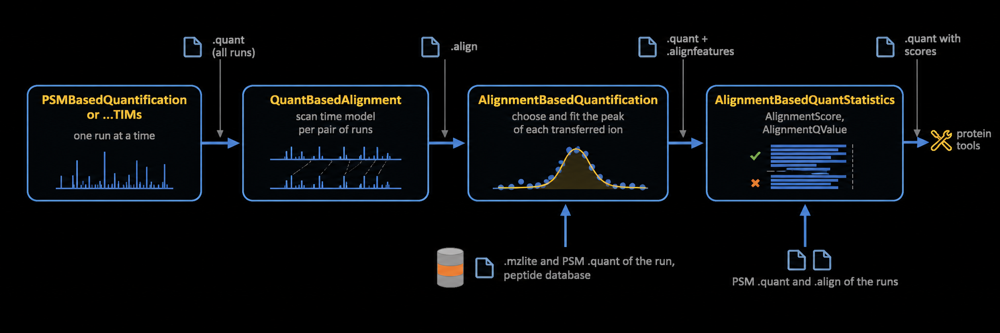

## Tool description

A peptide ion transferred by QuantBasedAlignment and quantified by AlignmentBasedQuantification has no identification in the run, so nothing yet says whether the quantified peak is the ion. AlignmentBasedQuantStatistics gives every such ion two values:

- `AlignmentScore`: the probability that the quantified peak is the ion's peak, given that the analyte is present in the run.
- `AlignmentQValue`: the estimated share of false quantifications among the new ions of the run that score at least as well. A quantification is false when the chosen peak is not the ion's peak or, unless `AbsentAnalyteFdr` is `Off`, when the analyte is absent from the run. 

New ions are the transferred ions without a PSM based quantification in the run. [JoinQuantPepIonsWithProteins](./join-quant-with-peptide-ions.md) reads the output. [LabelFreeProteinQuantification](./label-free-protein-quantification.md) and [LabeledProteinQuantification](./labeled-protein-quantification.md) filter on the Q-value only if their `Alignment_QValue` parameter is set. They then drop transferred rows with a q-value at or above it. All their default files set it to Some 0.05, and None keeps every transferred row.




## Training data and label
The tool learns from overlap ions: ions that a run identified and quantified itself and that were also transferred to it. For them the run's own PSM based peak is the reference. Let z be the distance between the transferred peak and the own peak, in units of the own peak's standard deviation.

| Label | Condition  | Use | 
| --- | --- | --- |
| Right | z ≤ `PositiveRtSdFactor` and \|log2 (transferred / own quantity)\| ≤ `MaxAbsLog2QuantRatio` | training |
| Ambiguous |  `PositiveRtSdFactor` < z ≤ `NegativeRtSdFactor`, same quantity bound | left out of training | 
| Wrong | everything else | training | 

Overlap ions whose own peak cannot serve as reference (no fitted peak, or a width or quantity that is not positive) get no label.

## Features 
All features come from the transferred row of `AlignmentBasedQuantification` and the `.align row`. None uses the ion's own `PSM row`, so the features of an overlap peptide ion look like those of a new peptide ion.

| Group | Features | 
| --- | --- |
| Scan time | residual to `PredictedScanTime` (signed, absolute, per peak sd, per local alignment error), the local alignment error, peak width and its ratio to the source peak | 
| Mass and isotopes | `ppm` of the monoisotopic peak, intensity weighted `ppm` over the isotope peaks, number of isotope peaks, similarity of the isotope pattern to the source, KL divergences to the theoretical pattern | 
| Chromatogram | correlation with the source trace (around the peak and over the whole XIC), DTW distance to the source trace, competing peaks in the XIC, share of the XIC maximum at the apex, XIC length, relative SEO | 
| Ion | source quantity and apex intensity, source scan time, m/z, charge
| Selection | from `<run>.alignfeatures`: `Sel_NCandidates`, `Sel_IsoCorr`, `Sel_IsoRatioLog2`, `Sel_ShapeCorr`, `Sel_RtZ`, `Sel_ImZ`, `Sel_LogRelHeight`, `Sel_AbsLog2FwhmRatio`, and `Sel_CandidateProbability`, `Sel_CandidateMargin` when all runs used the same selection model |
| Ion Mobility | `\|IonMobility − PredictedIonMobility\| / PredictedIonMobilitySd` (timsTOF only) |

- The local alignment error of an ion is the median `|own PSM    scan time − PredictedScanTime|` of the run's overlap ions predicted within ±2 min. Every run needs `<run>.alignfeatures` next to its aligned `.quant`.
- `UseIntensityRatioFeatures` adds four features: 
    - the ratios of target to source quantity
    - apex intensity
    - the target quantity
    - apex intensity. 
They are off by default: a model that prefers a ratio near 1 penalises peptides that really changed between the samples.


## Model, calibration and Q-Values 
1. **Split overlap ions into five folds**

    The overlap ions of all learning runs are pooled and split into 5 folds by peptide sequence, so the forms of a peptide stay together.
2. **Train a model per fold**

    Per fold, a gradient boosted tree model (ML.NET FastTree) is trained on the right and wrong ions of the other four folds. Unless AbsentAnalyteFdr is Off, the decoys of the learning runs join this training as wrong examples, in the fold of their peptide. 
3. **Calibrate model scores**

    Per fold, an isotonic calibration (the share of right ions as a non-decreasing function of the raw score) is fitted on the right and wrong overlap ions of the held-out fold. It turns scores into probabilities. Below the lowest fitted score the probability follows a logistic fit of the label on the raw score. A fold with fewer than 200 such ions, or with one label only, is calibrated on the held-out ions of all folds. If those are too few or of one label as well, the logistic fit alone is used. 
4. **Calculate the alignment score**

    The `AlignmentScore` p of a new peptide ion is the mean of the calibrated probabilities of the 5 fold models.
5. **Estimate the Q-value**

    The posterior error probability of a new ion is 1 − p. Per run, the new ions are sorted by p in descending order. The `AlignmentQValue` of an ion is the mean posterior error probability of all new ions with at least its p, made monotone. 
6. **Account for absent analytes**

    Unless AbsentAnalyteFdr is Off, the absent-analyte rate at the ion's score (see Absent analytes) is added to the q-value, which is made monotone again.

The highest probability the isotonic calibration can give grows with the number of right and wrong overlap ions it is fitted on: about 0.99 up to 2,000 ions, 0.999 from 20,000. With few overlap ions a cutoff of q ≤ 0.01 can therefore keep few or no transferred ions.

The log reports an out-of-fold check. Each overlap ion is scored by the fold model that did not see it and calibrated on the held-out ions of the other folds (by the logistic fit alone if those are too few or of one label). The true share of wrong peaks is given at q ≤ 0.01, 0.05 and 0.1, once with the ambiguous ions counted as wrong and once without them.

## Absent analytes 
The overlap ions are present in the run, so they cannot show how the model scores an ion whose analyte is absent. The decoy transfers of AlignmentBasedQuantification (`<run>.aligndecoy`) are used for that.

The false discovery rate (FDR) for absent analytes is calculated as follows:

$$
\operatorname{FDR}_{\text{absent}}(t)
=
\pi \cdot
\frac{\text{Decoys with } p \geq t}{\text{All decoys}}
\cdot
\frac{N_{\text{new}}}{N_{\text{new}}(p \geq t)}
$$

Where:

- **$N_{\text{new}}$:** Total number of new ions in the run.
- **$\pi$:** Fraction of new ions whose analyte is absent.
- **$t$:** Score threshold.
- **$p$:** Score used to evaluate an ion or decoy.

Two methods are available to determine $\pi$:

- **`Estimated`:** Estimates $\pi$ separately for each run using Storey's method with $\lambda = 0.5$.
- **`Conservative`:** Sets $\pi = 1$.

**Additional considerations:**

- Runs with fewer than 200 decoys use the combined decoys from all runs for scoring.
- Decoys without a fitted peak and new ions without an alignment row are assigned $p = 0$.
- If a run lacks a corresponding `<run>.aligndecoy` file next to its aligned `.quant` file, or if no decoy has a fitted peak, the tool issues a warning and behaves as `Off`. This also applies when `AlignmentBasedQuantification` was run with `DecoyFraction = 0`.

## Inputs

These inputs are needed to execute the tool:

| Flag | Description | Comes from |
| --- | --- | --- |
| `-i` | PSM based `.quant` of the runs to score | [PSMBasedQuantification](./psm-based-quantification.md) or [PSMBasedQuantificationTIMs](./psm-based-quantification-tims.md) |
| `-ii` | `.align` of the runs to score | [QuantBasedAlignment](./quant-based-alignment.md) |
| `-iii` | `aligned .quant` of the runs to score | [AlignmentBasedQuantification](./alignment-based-quantification.md) |
| `-l` | PSM based `.quant` of the runs to learn from | [PSMBasedQuantification](./psm-based-quantification.md) or [PSMBasedQuantificationTIMs](./psm-based-quantification-tims.md) |
| `-ll` | `.align` of the runs to learn from | [QuantBasedAlignment](./quant-based-alignment.md) |
| `-lll` | `aligned .quant` of the runs to learn from | [AlignmentBasedQuantification](./alignment-based-quantification.md) |
| `-o` | Output directory, created when missing | — |
| `-p` | Parameter file (JSON) | [Github ProteomIQon Core](https://github.com/CSBiology/ProteomIQon/blob/dev/src/ProteomIQon/defaultParams/AlignmentBasedQuantStatisticsParams.json) |
| `-c` | Number of runs read and written in parallel (default: 1) | — |
| `-ts` | Switch: write the overlap ions used for training from each learning run | — |
| `-dc` | Switch: write `AlignmentScoreHistogram.html` | — |
| `-mf` | Switch: pair input files by name instead of position | — |

- Each of the six run-input flags takes one file, several files, or a directory. Keep the `.alignfeatures` and, when present, `.aligndecoy` files beside their corresponding aligned `.quant` files. The runs to learn from are usually the runs to score. Without `-mf` the files are paired by position, the files of a directory sorted by name, and the numbers of files must agree.
- For every scored run the tool writes `<run>.quant` with the layout of the input `.quant` files: the PSM based rows of `-i` and one row per new peptide ion with `AlignmentScore` and `AlignmentQValue`.
- When the PSM row of an overlap ion has no fitted peak, the transferred row replaces it and is scored like a new ion. `-ts` writes `<run>.quanttestset` per learning run, with the overlap ions, their label, fold, raw and calibrated out-of-fold score, out-of-fold Q-value and features. 
- Logs go to `AlignmentBasedQuantStatistics_log.txt`, with the features, the out-of-fold check and the calibration per score bin and per source intensity quartile, and to one `<run>_log.txt` per run.

## Parameters 
| Parameter | Default | Description | 
| --- | --- | --- |
| PositiveRtSdFactor | `1.0`| A peak within this many own peak sd is right. | 
| NegativeRtSdFactor | `3.0`| Up to this many sd a peak is ambiguous, beyond it wrong. | 
| MaxAbsLog2QuantRatio | `1.0` | Right and ambiguous peaks need \|log2 (transferred / own quantity)\| at most this. |
| UseIntensityRatioFeatures | `false`| Add four features: target-to-source ratios for quantity and apex intensity, plus the target quantity and apex intensity. |
| UseIonMobility | `true`| Add the ion mobility feature when the rows have a finite `IonMobility` and the `.align` file a `PredictedIonMobilitySd` above 0. | 
| NumberOfFolds | `5`| Cross-validation folds. | 
| Trainer | `FastTree`| FastTree or LightGbm. LightGbm needs the native library lib_lightgbm, which the package ships for win-x64, linux-x64 and osx-x64.|
| NumberOfLeaves, NumberOfTrees, MinimumExampleCountPerLeaf, LearningRate | `null` | null takes the trainer's defaults: 20, 100, 10, 0.2 for FastTree; 31, 100, 20, 0.1 for LightGbm. |
| AbsentAnalyteFdr | `Estimated`| `Off`, `Estimated` or `Conservative`: whether and how the absent-analyte rate enters the q-value (see Absent analytes). | 
| Seed | `1`| Seed of the folds and of the trainer. |

## Parameter generation

For an F# example that writes a parameter JSON file, see the [parameter-generation example](https://github.com/CSBiology/ProteomIQon/blob/dev/docs/tools/AlignmentBasedQuantStatistics.fsx#L159).

## Running the tool 

1. **Installing**

   Install the Tool with the following command inside the choosen Command-Line

   ```sh
   dotnet tool install --global ProteomIQon.AlignmentBasedQuantStatistics
   ```

2. **Score every run, learn from all of them, pair the files by name, and work on four runs at a time**


     ```sh
    proteomiqon-alignmentbasedquantstatistics -i path/to/quant -ii path/to/align -iii path/to/aligned -l path/to/quant -ll path/to/align -lll path/to/aligned -o path/to/output -p path/to/AlignmentBasedQuantStatisticsParams.json -mf -c 4
     ```

3. **Save training examples and diagnostics**

   Add `-ts` to write the training ions and `-dc` to write the alignment-score histogram.

4. **All flags**

   ```sh
    proteomiqon-alignmentbasedquantstatistics --help
     ```

## Limitations 
- The false discovery rate of absent analytes is an estimate from decoys at a shifted scan time. Analytes near the detection limit are not modelled.
- The model needs overlap ions. With few identifications per run, or runs that share few ions, there is little to learn from.
