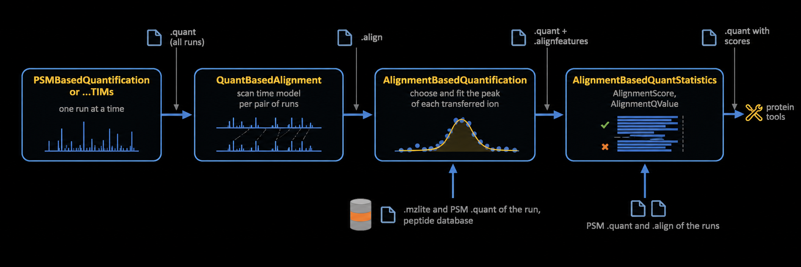
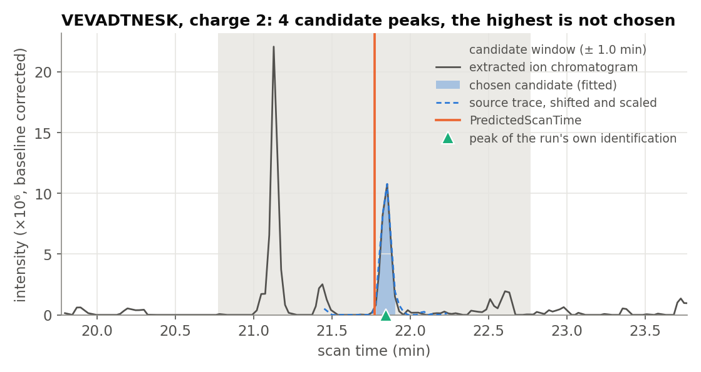

## Tool Description

QuantBasedAlignment predicts where a peptide ion identified in another run should elute in this run. 



## How does AlignmentBasedQuantification work?

1. **Extract transferred ion chromatograms**

    AlignmentBasedQuantification extracts the ion chromatogram (XIC) of every transferred ion around that prediction, decides which of the peaks in the XIC belongs to the ion, and fits that peak as PSMBasedQuantification does.
2. **Learn peak selection per run**

    The decision is made by a model that each run learns from the ions it identified itself. The output is a .quant file with the run's own quantifications followed by the transferred ones, which AlignmentBasedQuantStatistics then scores.
3. **Detect peaks in the chromatogram**

    The XIC is extracted over ±ScanTimeWindow around PredictedScanTime, baseline corrected, and its peaks are detected with the wavelet or second derivative method of the PSM based quantification. 
4. **Define the candidate window**

    Candidates are the peaks whose position lies within ±max(MinScanTimeWindow, ScanTimeWindowSdFactor · PredictedScanTimeSd) of the prediction, at most ±ScanTimeWindow. With the defaults this is ±1 min where the alignment is precise and up to ±2 min where it is not. 
5. **Describe each candidate**

    Each candidate gets the features below.
6. **Select and fit the best peak**

    A logistic regression gives each candidate a probability of being the ion's peak. The candidate with the highest probability is fitted.

A peak is always chosen when any candidate lies in the window, so this step never rejects an ion. Ions whose analyte is absent from the run are handled by AlignmentBasedQuantStatistics, which uses the decoy transfers described below.

|Feature | Description|
| --- | --- |
| Scan time distance | `candidate − PredictedScanTime` in units of PredictedScanTimeSd (at least 0.03 min), and its square | 
| Shape correlation | correlation of the candidate with the source trace, shifted onto the candidate | 
| Relative height | log10 of the candidate height relative to the highest candidate | 
| Width ratio | `\|log2\|` of the ratio of the widths at half height of candidate and source trace |
| Number of candidates | log2 of the number of candidates in the window | 
| Isotope evidence | correlation of the M0 and M+1 traces over the candidate, and log2 (M+1 / M0)  | 
| Mass error | `ppm` of the M0 m/z around the candidate apex| 
| Ion mobility distance | `candidate ion mobility − PredictedIonMobility` in units of `PredictedIonMobilitySd` (timsTOF only) | 

The model is trained per run on the ions the run identified itself and that [QuantBasedAlignment](./quant-based-alignment.md) also transferred (overlap ions). For these the right answer is known: the candidate within one standard deviation of the apex of the run's own PSM based peak. Only overlap ions with a reliable own fit (|search − apex of the fitted peak| < 2 standard deviations of the fitted peak) are used.

The training is cross-fitted: the peptides are split into 5 folds, and an overlap ion is decided by the model trained on the other four folds. New ions are decided by the model trained on all overlap ions.

A run with fewer than 200 training ions uses a fixed score instead: −0.5 · min(d², 50) + 4 · shape correlation + 2 · log10 relative height, with d the scan time distance.



In the figure four peaks lie in the candidate window. The highest is 0.6 min from the prediction. The model chooses the peak next to the prediction, whose shape matches the source trace. It is the peak of the run's own identification.

An ion that cannot be quantified gets no row, for example when no candidate lies in the window, the XIC is too short, or the peak detection or the fit fails. The reason is in `Status` of .`alignfeatures`.

### m/z window 

The tool measures the offset between observed and theoretical m/z in the MS1 spectra of ions the run quantified itself. After removing outliers it fits the offset in ppm as the sum of a function of scan time and a function of m/z. Every trace of an ion (monoisotopic, isotopes, labeled partner) is centred on its theoretical m/z plus the correction at the `PredictedScanTime` and that m/z.

With `MzWindow_Da` set to `Estimate` the half width is 4 standard deviations of the offsets that remain after the correction, the same at every m/z. `Fixed` sets the half width in Da and keeps the correction.

With fewer than 50 measured ions left, the correction is fitted on the precursor m/z of the .quant file instead, and `Estimate` uses a half width of 0.05 Da.

### ion mobility 
Ion mobility is used when the spectra and the `.align` file have it. An XIC point is then the sum of the intensity of all peaks inside the m/z window and inside the ion mobility window, as in PSMBasedQuantificationTIMs. Both widths are part of the quantity, so transferred and PSM based quantities are comparable when both tools use the same widths.

The traces of an ion, of its isotopes and of its labeled partner share one window, set by XicExtraction.`IonMobilityWindow`. The expected ion mobility of the ion is `PredictedIonMobility`, or its ion mobility in the source run when the `.align` row has no prediction.

- `Fixed v`: ±v around the ion mobility centre of the ion. The centre is the intensity weighted ion mobility of the signal within v of the expected ion mobility, around the PredictedScanTime. Without such signal it is the expected ion mobility.
- `Estimate`: ±max(0.05, 4 · PredictedIonMobilitySd) 1/K0 around the expected ion mobility, ±0.05 without prediction.

In a transferred row, `IonMobility` is the intensity weighted ion mobility of the chosen peak, measured within one fitted standard deviation of its apex. `IonMobilityCentre` is the ion mobility the traces were summed around: the centre with Fixed, the expected ion mobility with `Estimate`, `NaN` without ion mobility.

### Labeled quantification

With `PerformLabeledQuantification` other than `Unlabeled` the partner of the other label is extracted with the same windows. Its peak is the peak that contains the fitted scan time of the ion. With `RequirePeakAtScanTime` set to `false`, the peak with the closest apex is taken when none contains it. A partner that cannot be quantified keeps its m/z and traces but gets no quantity, and the row is kept. The ion's own peak is always the candidate chosen by the selection model.

An ion that the run did not quantify itself is not transferred when the PSM based row of its labeled partner has a fitted peak and a quantity of the ion's label. Its `Status` is `labeled partner quantified by its PSM based row`.

## Inputs 
| Flag | Description | Comes from | 
| --- | --- | --- |
| `-i` | `.mzlite` of the run, or a directory | [MzMLToMzLite](./mzml-to-mzlite.md) or [MzMLToMzLiteIonMobility](./mzml-to-mzlite-ion-mobility.md) |
| `-ii` | `.align` of the run, or a directory | [QuantBasedAlignment](./quant-based-alignment.md) | 
| `-iv` | `.quant ` of the same run, or a directory| [PSMBasedQuantification](./psm-based-quantification.md) or [PSMBasedQuantificationTIMs](./psm-based-quantification-tims.md) | 
| `-d`| peptide database (SQLite) | [PeptideDB](./peptide-db.md) | 
| `-o` | output directory, created when missing | - | 
| `-p` | the parameter file (JSON) | [Github ProteomIQon Core](https://github.com/CSBiology/ProteomIQon/blob/dev/src/ProteomIQon/defaultParams/AlignmentBasedQuantificationParams.json) | 
| `-mf` | switch: pair the files by base name instead of by position | - | 
| `-dc`| switch: `write <run>_mzCorrection.html` with the m/z offsets and their correction | - | 
| `-c`|  number of runs processed in parallel, one core each, default 1 | - | 

- Without -mf the files are paired by position, the files of a directory sorted by name. If the numbers of files differ, the tool stops.
- `<run>.quant` has the layout of the PSM based `.quant` files. It holds the PSM based rows with a fitted peak, then one row per quantified transferred ion with `QuantificationSource = Alignment`.
- These rows pass no quality filter. In these rows `Difference_SearchRT_FittedRT` is `PredictedScanTime` minus the `fitted scan time`. `AlignmentScore` and `AlignmentQValue` hold `NaN` until [AlignmentBasedQuantStatistics](./alignment-based-quant-statistics.md) fills them.
- `<run>.alignfeatures` is a tab separated table with one row per `.align` row. `AlignmentBasedQuantStatistics` reads it from the directory of the aligned `.quant` and uses its features. The main columns:

| Column | Description | 
| --- | --- |
| StringSequence, GlobalMod, Charge, PepSequenceID, ModSequenceID | Peptide Ion  | 
| CandidateProbability | probability of the chosen candidate, `nan` with the fixed score | 
| CandidateMargin | lead of the chosen candidate over the second best | 
| NCandidates | number of candidates | 
| RtZ, ImZ, ShapeCorr, LogRelHeight, AbsLog2FwhmRatio, IsoCorr, IsoRatioLog2, AbsPpmMono | the features of the chosen candidate | 
| SelectionModel | `Logistic` or `FixedScore` | 
| CandidateScanTime | position of the chosen candidate, in minutes | 
| ScanTimeWindow, MzWindow, IonMobilityWindow | half widths of the windows used | 
| Status | `quantified`, or why the peptide ion was not quantified | 

- With DecoyFraction above 0, `<run>.aligndecoy` holds the decoy transfers: a share of the new ions quantified a second time with `PredictedScanTime` shifted by 4 to 6 minutes, where their own peak is not.
- A decoy is skipped when the ion's own peak could lie in its XIC. Each row has the .quant columns, the shifted `PredictedScanTime` and the `.alignfeatures` feature columns.
- [AlignmentBasedQuantStatistics](./alignment-based-quant-statistics.md) uses them to estimate how often a peptide ion whose analyte is absent from the run passes the Q-value cutoff. They never enter `<run>.quant`.
- Logs go to `AlignmentBasedQuantification_log.txt` and one `<run>_log.txt` per run, with the counts of ions per reason at Info level and each peptide ion that was not quantified at Debug level.

The tool overwrites its `.quant` and `.alignfeatures` outputs for the run. If decoy transfers are disabled, it removes an existing `.aligndecoy` for that run.

## Parameters 
| Parameter | Default | Description | 
| --- | --- | --- |
| PerformLabeledQuantification | `Labeling.N15Labeling` |  	Also quantify the partner of the other label. `Unlabeled` quantifies only the ion itself, for label-free data. `N15Labeling`, `N15LabelingOnly` and `Labelshift` behave the same here. |
|  XicExtraction | see below | How the XIC is extracted and processed. |
|  BaseLineCorrection | `Some { MaxIterations = 10; Lambda = 6; P = 0.05 }`| Asymmetric least squares baseline of the XIC. None switches it off. | 
| MinScanTimeWindow | `1.0` | Smallest half width of the candidate window, in minutes. | 
| ScanTimeWindowSdFactor | `8.0` | Half width of the candidate window in units of `PredictedScanTimeSd`, if larger than `MinScanTimeWindow`. | 
| DecoyFraction | `0.2` | Share of the new ions that also get a decoy transfer. 0 writes no decoys. | 
| Seed | `1`| Seed of the cross-fitting folds and of the choice of the decoys. | 
| RequirePeakAtScanTime | `true`| Whether the labeled partner needs a peak that contains the fitted scan time of the ion (see Labeled quantification). | 

**XIC Extraction**

|XicExtraction field | Default | Description | 
| --- | --- | --- |
| ScanTimeWindow | `2.0`| Half width of the XIC in minutes, and the largest half width of the candidate window. | 
| MzWindow_Da | `Window.Estimate`| `Estimate` measures the m/z window from the run. Window.Fixed 0.01 sets ±0.01 Da. | 
| XicProcessing | `XicProcessing.Wavelet` | Peak detection. The wavelet fields are described on the [PSMBasedQuantification](./psm-based-quantification.md) page. The default `BorderPadMethod` is Zero. `Random` is accepted with a warning, because it makes the detected peaks differ between reruns. | 
| TopKPSMs | `None` | Not used | 
| IonMobilityWindow | `Window.Estimate` | `Estimate` or `Window.Fixed v`, in 1/K0 (see Ion mobility). | 

For timsTOF runs, [AlignmentBasedQuantificationTIMsParams.json](https://github.com/CSBiology/ProteomIQon/blob/dev/src/ProteomIQon/defaultParams/AlignmentBasedQuantificationTIMsParams.json) sets the m/z half width to `Window.Fixed 0.008` Da and the ion mobility half width to `Window.Fixed 0.025` in 1/K0. These match the defaults in [PSMBasedQuantificationTIMs](./psm-based-quantification-tims.md). Suitable windows depend on the instrument and acquisition method.

## Parameter generation

For an F# example that writes a parameter JSON file, see the [parameter-generation example](https://github.com/CSBiology/ProteomIQon/blob/dev/docs/tools/AlignmentBasedQuantification.fsx#L183).

## Running the tool 

1. **Installing**

   Install the Tool with the following command inside the choosen Command-Line

   ```sh
   dotnet tool install --global ProteomIQon.AlignmentBasedQuantification
   ```

2. **Quantify one run**


     ```sh
    proteomiqon-alignmentbasedquantification -i path/to/run.mzlite -ii path/to/run.align -iv path/to/run.quant -d path/to/peptides.db -o path/to/output -p path/to/AlignmentBasedQuantificationParams.json
     ```

3. **Process every run in a set of directories, paired by file name, four at a time**

   ```sh
    proteomiqon-alignmentbasedquantification -i path/to/mzlite -ii path/to/align -iv path/to/quant -d path/to/peptides.db -o path/to/output -p path/to/AlignmentBasedQuantificationParams.json -mf -c 4
     ```

4. **All Flags**

    ```sh
     proteomiqon-alignmentbasedquantification --help
     ```

## Limitations 
- MinScanTimeWindow (1 min) and ScanTimeWindow (2 min) are fixed in minutes and do not scale with the gradient length.
- The fixed score uses the same weights in every run.
- The right peak must be among the detected peaks. Shoulders that the peak detection merges with a neighbour cannot be chosen separately.
