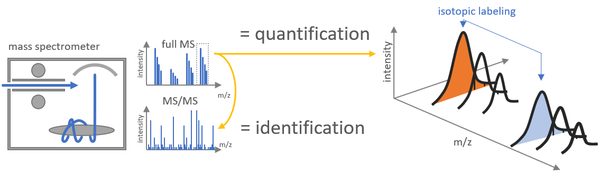

## Tool Description

In **15N metabolic labeling**, a sample containing heavy (15N-labeled) peptides is mixed with a light (14N) sample. Both forms are measured in the same mass spectrometry run. Comparing their intensities makes it possible to quantify differences between the two samples.

After [JoinQuantPepIonsWithProteins](./join-quant-with-peptide-ions.md), each quantified peptide ion is assigned to a protein group. **LabeledProteinQuantification** combines the light and heavy peptide intensities and calculates a light-to-heavy ratio for each protein group and run.

The results can be passed to [RatioLFQ](./ratio-lfq.md) for further analysis.

BioFSharp.Mz explains how [isotopic labels enter the search](https://www.biofsharp.com/BioFSharp.Mz/02_02_search_databases.html#Describing-the-search-space) and how the [two peaks are quantified](https://www.biofsharp.com/BioFSharp.Mz/03_01_quantification.html#From-one-peak-to-a-pipeline).



## How does Labeled Protein Quantification work?

The tool applies `ModificationFilter` when it reads the input rows, before any aggregation.

The tool processes peptide-ion quantifications in **four aggregation steps**. The first and last steps are mandatory; the two intermediate steps are optional.

1. **Aggregate light and heavy peptide forms (mandatory)**

   For each peptide ion, the tool calculates `Ratio_LightByHeavy` from the light and heavy intensities. It also combines rows identified from the light and heavy versions of the same peptide ion.

   An optional correlation threshold can remove rows whose light and heavy elution profiles do not agree sufficiently.

2. **Aggregate peptide charge states (optional)**

   Peptide ions with the same sequence and modifications but different precursor charge states can be combined into one set of light, heavy and ratio values.

3. **Aggregate modified peptides (optional)**

   Different modified versions of the same peptide sequence can be combined.

4. **Aggregate to protein groups (mandatory)**

   The remaining peptide-level measurements are combined for each protein group and run, producing aggregated light intensity, heavy intensity and light-to-heavy ratio.

Each aggregation step can **transform values, filter individual measurements, remove outliers within groups and aggregate the remaining values**. The filters are configured per series, but a row that any filter rejects is removed from all three series.

### What happens when stages are skipped?

If charge-state aggregation is disabled, charge states remain separate during the following steps. If modification aggregation is disabled, modified forms are not merged at that stage. When both are disabled, protein-group aggregation works directly on the results of the mandatory light/heavy aggregation step.

## Inputs

| Flag | Meaning | Comes from |
| --- | --- | --- |
| `-i` | One or more `.quantAndProt` files, or a directory containing these files. Each row contains peptide quantification together with a protein-group assignment. | [JoinQuantPepIonsWithProteins](./join-quant-with-peptide-ions.md) |
| `-o` | Directory in which the output tables and log files are saved. The directory is created if necessary. | Chosen output location |
| `-p` | JSON parameter file controlling filtering, transformations and aggregation. | [Default parameter file](https://github.com/CSBiology/ProteomIQon/blob/dev/src/ProteomIQon/defaultParams/LabeledQuantificationParams.json) |

**Important:** Protein-group assignments must already be present in the `.quantAndProt` input. The tool does not perform peptide identification or protein inference itself.

## Parameter file

### General settings

| Parameter | Default | Description |
| --- | --- | --- |
| `Correlation_Light_Heavy_Threshold` | `None` | Optional minimum correlation between light and heavy elution profiles. For example, `Some 0.9` retains rows with a correlation above 0.9. The filter runs during the first aggregation step. |
| `Alignment_QValue` | `Some 0.05` | Excludes transferred rows with an alignment q-value at or above the threshold. PSM-based rows carry an alignment q-value of `0`, and rows with no alignment q-value are kept. `None` disables the filter. |
| `ModificationFilter` | `UseModifiedPeptides.All` | Filters peptides when reading the input. `All` accepts all peptides, `No` excludes modified peptides, and `UseOnly` accepts unmodified peptides plus peptides carrying only the specified modifications. |
| `AggregateGlobalModificationsParams` | Mean for light, heavy and ratio; no transformations or filters | Settings for combining identifications of the light and heavy versions of each ion. This step always runs. |
| `AggregatePeptideChargeStatesParams` | `None` | When set to `Some AggregationParams`, combines different charge states. `None` skips this step. |
| `AggregateModifiedPeptidesParams` | `None` | When set to `Some AggregationParams`, combines different modified peptide forms. `None` skips this step. |
| `AggregateToProteinGroupsParams` | Mean for light, heavy and ratio; no transformations or filters | Settings for the final protein-group aggregation. This step always runs. |

### Light/heavy aggregation

`AggregateGlobalModificationsParams` controls the **mandatory first step**. It combines peptide-ion identifications originating from either labeled form and produces three measurements:

- `Quant_Light`: Intensity of the light peptide form.
- `Quant_Heavy`: Intensity of the heavy peptide form.
- `Ratio_LightByHeavy`: Ratio calculated from light and heavy intensities.

The optional `Correlation_Light_Heavy_Threshold` is applied at this stage.

### Charge-state aggregation

Set `AggregatePeptideChargeStatesParams` to `Some AggregationParams` to merge measurements of the same modified peptide across different charge states.

Set it to `None` (JSON `null`) to skip this step. The official charge-aggregation presets use the **mean** of light, heavy and ratio values without additional filtering or transformations.

### Modification aggregation

Set `AggregateModifiedPeptidesParams` to `Some AggregationParams` to merge different modified forms of the same peptide sequence.

Set it to `None` (JSON `null`) to skip the step. In the supplied preset that enables both optional stages, the light, heavy and ratio series are each aggregated using the **mean**.

### Protein-group aggregation

`AggregateToProteinGroupsParams` controls the **mandatory final step**. Peptide measurements associated with the same protein group and run are combined into protein-level light, heavy and ratio values.

Unlike the two optional intermediate stages, this parameter must contain an aggregation configuration.

### Shared aggregation settings

Every enabled stage uses the same four-field `LabeledProteinQuantification.AggregationParams` structure. Each setting can be configured independently for **Light**, **Heavy** and **Ratio**.

| Parameter | Default | Description |
| --- | --- | --- |
| `LabeledTransform` | `None` | Optional numeric transformation applied before filtering. Supported operations: `Log2`, `Add`, `Substract`, `MultiplyBy` and `DivideBy`. A series set to `None` remains unchanged. |
| `LabeledSingleFilters` | `None` | Filters individual measurements using `IsBiggerThan` or `IsSmallerThan`. A row must pass every configured filter of all three series. |
| `LabeledGroupFilters` | `None` | Filters each aggregation group. `Tukey factor` uses the interquartile-range multiplier, `Stdev factor` keeps values within that many standard deviations of the mean, and `TopX count` selects the highest values using an integer count. |
| `LabeledAggregation` | `{ Light = Mean; Heavy = Mean; Ratio = Mean }` | Specifies how the remaining values are combined independently for each series. Choices: `Mean`, `Median` and `Sum`. |

This F# configuration log₂-transforms all three series, keeps only rows whose transformed ratio is below zero, removes rows that are Tukey outliers in the transformed light values, and averages each series. A row that any filter rejects is removed from all three series.

```fsharp
let example : Common.LabeledProteinQuantification.AggregationParams =
    {
        LabeledTransform =
            Some { Light = Some Log2; Heavy = Some Log2; Ratio = Some Log2 }
        LabeledSingleFilters =
            Some { Light = None; Heavy = None; Ratio = Some (seq [IsSmallerThan 0.0]) }
        LabeledGroupFilters =
            Some { Light = Some (seq [Tukey 1.5]); Heavy = None; Ratio = None }
        LabeledAggregation =
            { Light = Mean; Heavy = Mean; Ratio = Mean }
    }
```

**JSON format:** Optional F# values set to `None` are stored as `null`. An aggregation choice such as `Mean` is represented by an object like `{"Case": "Mean"}`.

### Default parameter files

The repository provides **five presets**:

1. [LabeledQuantificationParams.json](https://github.com/CSBiology/ProteomIQon/blob/dev/src/ProteomIQon/defaultParams/LabeledQuantificationParams.json) — Runs the mandatory light/heavy and protein-group aggregation steps, using the mean for each series.
2. [LabeledQuantificationParams_withCorrFilter.json](https://github.com/CSBiology/ProteomIQon/blob/dev/src/ProteomIQon/defaultParams/LabeledQuantificationParams_withCorrFilter.json) — Adds a light/heavy correlation threshold of `0.9`.
3. [LabeledQuantificationParams_CorrFilter_ChargeAgg.json](https://github.com/CSBiology/ProteomIQon/blob/dev/src/ProteomIQon/defaultParams/LabeledQuantificationParams_CorrFilter_ChargeAgg.json) — Uses a correlation threshold of `0.0` and enables charge-state aggregation with the mean.
4. [LabeledQuantificationParams_CorrFilter_ChargeAgg_ModAgg.json](https://github.com/CSBiology/ProteomIQon/blob/dev/src/ProteomIQon/defaultParams/LabeledQuantificationParams_CorrFilter_ChargeAgg_ModAgg.json) — Uses a correlation threshold of `0.0` and enables both charge-state and modification aggregation with the mean.
5. [LabeledQuantificationParams_Transform_Filter_Sum.json](https://github.com/CSBiology/ProteomIQon/blob/dev/src/ProteomIQon/defaultParams/LabeledQuantificationParams_Transform_Filter_Sum.json) — Applies `Log2` to light, heavy and ratio in the first step, retains log2 ratios below `0.0`, and aggregates protein-level light and heavy values with `Sum` while ratios use `Mean`.

All five linked presets specify an alignment Q-value threshold of `0.05`.


## Outputs

The tool writes **three mandatory** and **up to two optional** tab-separated result tables.

| File | Output content | When produced |
| --- | --- | --- |
| `GlobModAggregation.txt` | Peptide-ion values after combining light/heavy identifications, including `Quant_Light`, `Quant_Heavy` and `Ratio_LightByHeavy`. | Always |
| `ChargeAggregation.txt` | Measurements after aggregation across charge states. | Only if `AggregatePeptideChargeStatesParams` is enabled |
| `ModificationAggregation.txt` | Measurements after aggregation across modified peptide forms. | Only if `AggregateModifiedPeptidesParams` is enabled |
| `ProteinAggregation.txt` | One row per protein group and run, with aggregated light, heavy and ratio values. Includes the number of observations used, coefficient of variation (CV), standard deviation and standard error of the mean (SEM) for each series. | Always |
| `LabeledQuant.txt` | Protein-group results in a wide table: one row per protein group and a set of columns for each input run. Column names follow patterns such as `<run>.Ratio_LightByHeavy` and `<run>.Quant_Heavy`. | Always |

**Next step:** [RatioLFQ](./ratio-lfq.md) uses `LabeledQuant.txt` to derive comparable run-level intensities from the ratios.

### Log files

Two additional files are written to the output directory:

| File | Description |
| --- | --- |
| `LabeledProteinQuantification_log.txt` | Log messages from the protein quantification tool. |
| `LabeledQuantification_log.txt` | Additional log messages from the labeled quantification process. |

## Parameter generation

From the ProteomIQon repository root, build the library with `dotnet build src/ProteomIQon/ProteomIQon.fsproj -c Release`. Save the following as `generate-params.fsx` in that same directory and run `dotnet fsi generate-params.fsx`. The script writes the JSON file to the system temporary directory.

```fsharp
#r "nuget: Newtonsoft.Json, 13.0.4"
#r "./src/ProteomIQon/bin/Release/net10.0/ProteomIQon.dll"

open System.IO
open ProteomIQon

// Used for the first step and the protein step of the default file: no transform, no filters, mean of light, heavy and ratio.
let meanOfAll : Common.LabeledProteinQuantification.AggregationParams =
    {
        LabeledTransform     = None
        LabeledSingleFilters = None
        LabeledGroupFilters  = None
        LabeledAggregation   =
            {
                Light = NumericAggregation.Mean
                Heavy = NumericAggregation.Mean
                Ratio = NumericAggregation.Mean
            }
    }

let labeledQuantificationParams : Dto.LabeledQuantificationParams =
    {
        Correlation_Light_Heavy_Threshold  = None
        Alignment_QValue                   = Some 0.05
        ModificationFilter                 = UseModifiedPeptides.All
        AggregateGlobalModificationsParams = meanOfAll
        AggregatePeptideChargeStatesParams = None
        AggregateModifiedPeptidesParams    = None
        AggregateToProteinGroupsParams     = meanOfAll
    }

// Replace the temp folder with your project folder.
let outputPath = Path.Combine(Path.GetTempPath(), "LabeledQuantificationParams.json")

Json.serializeAndWrite outputPath labeledQuantificationParams
```

## Installing and executing the tool

1. **Installing**

   Install the tool globally with the .NET CLI:

   ```sh
   dotnet tool install --global ProteomIQon.LabeledProteinQuantification
   ```

2. **Execute a single run**

   ```sh
   proteomiqon-labeledproteinquantification -i path/to/run.quantAndProt -o path/to/output -p path/to/LabeledQuantificationParams.json
   ```

3. **Several runs in one table, from a list or from a directory**

   Provide several input files or a directory containing `.quantAndProt` files:

   ```sh
   proteomiqon-labeledproteinquantification -i path/to/run1.quantAndProt path/to/run2.quantAndProt -o path/to/output -p path/to/LabeledQuantificationParams.json

   proteomiqon-labeledproteinquantification -i path/to/quantAndProt -o path/to/output -p path/to/LabeledQuantificationParams.json
   ```

4. **All flags**

   ```sh
   proteomiqon-labeledproteinquantification --help
   ```
