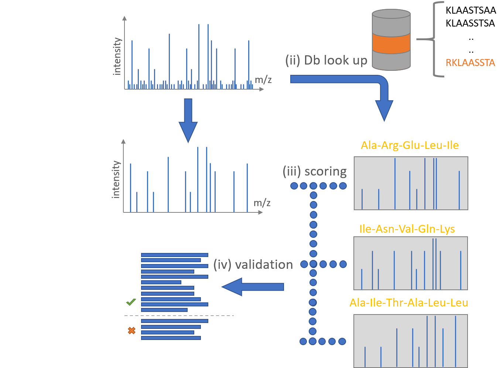

## Tool Description

PeptideSpectrumMatching identifies the peptides behind the MS/MS spectra of a run.

## How does PeptideSpectrumMatching work?

1. **Charge state determination**

   For each MS2 scan it first [determines the charge of the precursor ion](https://www.biofsharp.com/BioFSharp.Mz/01_03_charge_state_determination.html) from the isotope pattern in the preceding MS1 scan.

2. **Comparison with PeptideDB**

   With the charge, the precursor m/z becomes a peptide mass, and the tool fetches every peptide from the [PeptideDB](./peptide-db.md) database whose mass lies within LookUpPPM of it.

3. **Fragmentation**

   For each candidate it computes the [theoretical fragment ions](https://www.biofsharp.com/BioFSharp.Mz/02_01_fragmentation.html) and compares them with the measured spectrum.

4. **Scoring**

   Each candidate gets a [SEQUEST-like score](https://www.biofsharp.com/BioFSharp.Mz/02_03_sequest_like_scoring.html) and an [Andromeda-like score](https://www.biofsharp.com/BioFSharp.Mz/02_04_andromeda_like_scoring.html). An X!Tandem-like score is computed alongside the Andromeda one.

5. **Decoys**

   Each peptide has a decoy with its C-terminal residue kept in place and the remaining residues reversed. A peptide that this leaves unchanged, such as AAAAK, is reversed completely. [PSMStatistics](./psm-statistics.md) uses the decoys to estimate the false discovery rate. See [how decoys are used](https://www.biofsharp.com/BioFSharp.Mz/02_03_sequest_like_scoring.html#What-the-decoys-are-for).



## Inputs

These inputs are needed to execute the tool:

| Flag | Meaning | Comes from |
| --- | --- | --- |
| `-i` | one or more `.mzlite` or `.mzML` files, or a directory searched for `*.mzlite`, `*.mzML` and `*.mzml` (not recursive) | [MzMLToMzLite](./mzml-to-mzlite.md) |
| `-d` | the SQLite peptide database | [PeptideDB](./peptide-db.md) |
| `-o` | the output directory, created when missing | - |
| `-p` | the parameter file in JSON | [peptideSpectrumMatchingParams.json](https://github.com/CSBiology/ProteomIQon/blob/main/src/ProteomIQon/defaultParams/peptideSpectrumMatchingParams.json) |
| `-c` | number of runs scored at the same time, default 1 | - |

- All four flags are mandatory. The reader opens files by extension and knows .mzlite and .mzML only, so an mzML file has to carry the extension in exactly that spelling. The tool stops when the database file does not exist.
- The tool writes one `<run>.psm` per input into the output directory. It is a tab separated table with a header.
- Each row is one candidate peptide for one spectrum with its charge, precursor m/z, theoretical mass, the three scores with their delta values to the next candidates, the peptide sequence and a Label of 1 for a target peptide and -1 for a decoy.
- The row ends with the five columns IonMobility, Hyperscore, Expectscore, MatchedIons and TotalIons, which PeptideSpectrumMatchingTIMs fills while this tool writes NaN in the float columns and 0 in the integer columns.
- The `.psm` is read by [PSMStatistics](./psm-statistics.md). The output directory also receives `PeptideSpectrumMatching_log.txt` and one `<run>_log.txt` per input.

## Parameter file

### General parameters

| Parameter | Default | Meaning |
| --- | --- | --- |
| `LookUpPPM` | 30.0 | Mass window, in ppm around the precursor mass, from which candidate peptides are fetched. |
| `nTerminalSeries` | NTerminalSeries.B | Fragment ion series counted from the N terminus. Keep B, the scoring builds the theoretical spectra from the b and y series. |
| `cTerminalSeries` | CTerminalSeries.Y | Fragment ion series counted from the C terminus. Keep Y. |
| `Andromeda` | `{ PMinPMax = 4, 10; MatchingIonTolerancePPM = 100.0 }` | Settings of the Andromeda-like and X!Tandem-like scoring. |
| `ChargeStateDeterminationParams` | See below | Settings of the precursor charge state determination. |

### Charge state determination

`ChargeStateDeterminationParams` uses the BioFSharp.Mz `ChargeState.ChargeDetermParams` record.

| Parameter | Default | Meaning |
| --- | --- | --- |
| `ExpectedMinimalCharge` | 2 | Lowest precursor charge that is tested. |
| `ExpectedMaximumCharge` | 5 | Highest precursor charge that is tested. |
| `Width` | 1.1 | Width of the m/z window around the precursor in which the MS1 isotope pattern is examined. |
| `MinIntensity` | 0.15 | Minimum relative intensity of a peak to count as part of the isotope pattern. |
| `DeltaMinIntensity` | 0.3 | Minimum relative intensity difference used when comparing neighbouring peaks of the pattern. |
| `NrOfRndSpectra` | 10000 | Number of random spectra used to estimate how likely a matching pattern arises by chance. |

### Andromeda scoring

`Andromeda` groups the two settings below in the `AndromedaParams` record.

| Parameter | Default | Meaning |
| --- | --- | --- |
| `PMinPMax` | 4, 10 | Lowest and highest number of most intense peaks kept per 100 Da window. Every count in between is tried and the best score is kept. |
| `MatchingIonTolerancePPM` | 100.0 | Tolerance in ppm for matching a theoretical fragment to a measured peak. |

Peptide mass and length limits, isotopic labels and peptide modifications are set when building the database with [PeptideDB](./peptide-db.md).

- The default file is [peptideSpectrumMatchingParams.json](https://github.com/CSBiology/ProteomIQon/blob/main/src/ProteomIQon/defaultParams/peptideSpectrumMatchingParams.json).

## Outputs

Every input run generates `<run>.psm` in the output directory, as a header-containing, tab-delimited file. Existing PSM files are overwritten.

The table contains 28 columns. `Label` is `1` for targets and `-1` for decoys. PSMStatistics recalculates `MissCleavages`, which is set to `-1` here.

### Classic PSM columns (23)

| Column | Description |
| --- | --- |
| PSMId | MS/MS spectrum match identifier |
| GlobalMod | Whether the peptide ion species is labeled or unlabeled |
| PepSequenceID | Unmodified peptide sequence identifier in PeptideDB |
| ModSequenceID | Modified peptide sequence identifier in PeptideDB, including PTMs |
| Label | Target (+1) or decoy (-1) |
| ScanNr | 0-based position of the MS2 spectrum in scan-time order, counting only the searched spectra (with peaks and a preceding MS1) |
| ScanTime | MS2 retention time in minutes |
| Charge | Precursor charge |
| PrecursorMZ | Precursor mass-to-charge ratio |
| TheoMass | Theoretical peptide mass in Da |
| AbsDeltaMass | Absolute difference between the theoretical peptide mass and the measured precursor mass |
| PeptideLength | Number of peptide amino acids |
| MissCleavages | Value -1 at this stage recomputed by PSMStatistics |
| SequestScore | SEQUEST-like similarity score |
| SequestNormDeltaBestToRest | Normalized separation of best score from remaining candidates |
| SequestNormDeltaNext | Normalized separation of top two candidate scores |
| AndroScore | Andromeda-like match score |
| AndroNormDeltaBestToRest | Normalized best-to-rest Andromeda score separation |
| AndroNormDeltaNext | Normalized top-two Andromeda score separation |
| XtandemScore | X!Tandem-like match score |
| XtandemNormDeltaBestToRest | Normalized best-to-rest X!Tandem score separation |
| XtandemNormDeltaNext | Normalized top-two X!Tandem score separation |
| StringSequence | Matching peptide amino acid sequence in one letter code |

### Additional columns (5)

These columns share the output layout with [PeptideSpectrumMatchingTIMs](./peptide-spectrum-matching-tims.md).

| Column | Value written by PeptideSpectrumMatching |
| --- | --- |
| `IonMobility` | `NaN` |
| `Hyperscore` | `NaN` |
| `Expectscore` | `NaN` |
| `MatchedIons` | `0` |
| `TotalIons` | `0` |

### Logs

The output folder also contains `PeptideSpectrumMatching_log.txt` and one `<run>_log.txt` for each run.

## Parameter generation

From the ProteomIQon repository root, build the library with `dotnet build src/ProteomIQon/ProteomIQon.fsproj -c Release`. Save the following as `generate-params.fsx` in that same directory and run `dotnet fsi generate-params.fsx`. The script writes the JSON file to the system temporary directory.

```fsharp
#r "nuget: BioFSharp.Mz, 0.2.3"
#r "nuget: Newtonsoft.Json, 13.0.4"
#r "./src/ProteomIQon/bin/Release/net10.0/ProteomIQon.dll"

open BioFSharp.Mz
open ProteomIQon

let chargeDetermParams : ChargeState.ChargeDetermParams =
    {
        ExpectedMinimalCharge = 2
        ExpectedMaximumCharge = 5
        Width                 = 1.1
        MinIntensity          = 0.15
        DeltaMinIntensity     = 0.3
        NrOfRndSpectra        = 10000
    }

let andromedaParams : Domain.AndromedaParams =
    {
        PMinPMax                = 4, 10
        MatchingIonTolerancePPM = 100.0
    }

let peptideSpectrumMatchingParams : Dto.PeptideSpectrumMatchingParams =
    {
        ChargeStateDeterminationParams = chargeDetermParams
        LookUpPPM                      = 30.0
        nTerminalSeries                = NTerminalSeries.B
        cTerminalSeries                = CTerminalSeries.Y
        Andromeda                      = andromedaParams
    }

// Replace the temp folder with your project folder.
let outputPath = System.IO.Path.Combine(System.IO.Path.GetTempPath(), "peptideSpectrumMatchingParams.json")

Json.serializeAndWrite outputPath peptideSpectrumMatchingParams
```

## Installing and executing the tool

1. **Installing**

   Install the tool globally with the .NET CLI.

   ```sh
   dotnet tool install --global ProteomIQon.PeptideSpectrumMatching
   ```

2. **Execute**

     ```sh
     proteomiqon-peptidespectrummatching -i path/to/run.mzlite -d path/to/AraTest.db -o path/to/output -p path/to/peptideSpectrumMatchingParams.json
     ```

3. **Running the tool for multiple runs, for three at the same time**

   ```sh
   proteomiqon-peptidespectrummatching -i path/to/run1.mzlite path/to/run2.mzlite path/to/run3.mzlite -d path/to/AraTest.db -o path/to/output -p path/to/peptideSpectrumMatchingParams.json -c 3
   ```

4. **All Flags**

   ```sh
   proteomiqon-peptidespectrummatching --help
   ```
