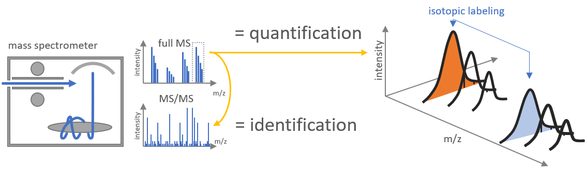

## Tool Description

PSMBasedQuantification turns the identifications from [PSMStatistics](./psm-statistics.md) into peptide ion intensities.

## How does PSMBasedQuantification work?

1. **XIC Extraction**

   For every identified peptide ion (sequence, modification state and charge) it takes the scan times of its MS/MS identifications, extracts an [ion chromatogram](https://www.biofsharp.com/BioFSharp.Mz/03_01_quantification.html#Building-an-XIC-trace) of the monoisotopic m/z in a window around them, detects the peaks in that trace and [fits the peak](https://www.biofsharp.com/BioFSharp.Mz/03_01_quantification.html#Fitting-and-integrating-the-main-peak) that contains the weighted scan time of its identifications (see `CentrePSMs` and `RequirePeakAtScanTime`). The fitted area is the reported `quantity`.

2. **Metabolic labelling**

   For metabolically labeled samples the tool computes the m/z of the partner ion (the heavy form of a light identification, or the other way round) and quantifies that trace as well, so every row can carry a light and a heavy value.



## Inputs

These inputs are needed to execute the tool:

| Flag | Meaning | Comes from |
| --- | --- | --- |
| `-i` | one or more `.mzlite` files, or a directory | [MzMLToMzLite](./mzml-to-mzlite.md) |
| `-ii` | one or more `.qpsm` files, or a directory that is searched for `*.qpsm` |[PSMStatistics](./psm-statistics.md)  |
| `-o` | the output directory, created when missing | - |
| `-d` | the SQLite peptide database | [PeptideDB](./peptide-db.md) |
| `-p` | the parameter file in JSON | [QuantificationParams.json](https://github.com/CSBiology/ProteomIQon/blob/main/src/ProteomIQon/defaultParams/QuantificationParams.json) |
| `-mf` | switch: pair files by base name instead of by position | - |
| `-dc` | switch: write diagnostic charts | - |
| `-z` | switch: pack the chart directory into a zip file and delete it | - |
| `-c` | number of runs quantified at the same time, default 1 | - |

- The input must be `.mzlite`. A directory given to `-i` is also scanned for `.mzML`, but the tool opens every file with the mzlite reader and fails on anything else, so convert first. With one file per flag the pair is used as given. With lists, the n-th mzlite file is paired with the n-th qpsm file unless you pass `-mf`, which pairs files by their base name (run1.mzlite with run1.qpsm) and skips mzlite files without a partner.

- For every run the tool writes `run.quant`, tab separated with a header and one row per quantified peptide ion.

- Next to the identifiers and the best Q-value and PEP value of the ion it reports:

  - the fitted quantity (Quant_Light, Quant_Heavy)
  - the apex intensity
  - the fit parameters
  - the difference between identification and fitted scan time
  - and the extracted traces and the isotope pattern for both channels.

- With `-dc` the tool writes a chart per peptide ion and the m/z correction chart `mzErrorAndCorrection.html` into `<run>_plots`. On successful archiving, `-z` writes `<run>_plots.zip` and removes that directory.

- Delete an existing `run.quant` in the output directory before a rerun, the tool appends to it. Logs go to `PSMBasedQuantification_log.txt` and `run_log.txt` in the output directory.

## Parameter file

### General settings

| Parameter | Default | Description |
|-----------|---------|---------|
| `PerformLabeledQuantification` | `Labeling.N15Labeling` | `Unlabeled` quantifies only the identified ion. `N15Labeling` quantifies the partner ion too and keeps rows where both fits pass the quality filter. `N15LabelingOnly` applies the filter to the heavy channel alone. `Labelshift` quantifies both and skips the filter. |
| `XicExtraction.ScanTimeWindow` | `2.0` | Half width of the scan time window around the identification that is extracted and searched for the peak, in the scan time unit of the run. |
| `XicExtraction.MzWindow_Da` | `Window.Estimate` | Half width of the m/z window of the trace, in Da, the same at every m/z. The trace is centred on the m/z corrected by an offset that the tool fits on the precursor m/z of the identifications, in ppm over retention time and m/z. `Estimate` uses four times the standard deviation of the difference between the measured and theoretical precursor m/z of the identifications, leaving out outliers. `Window.Fixed 0.07` sets 0.07 Da. |
| `XicExtraction.XicProcessing` | `XicProcessing.Wavelet waveletParams` | Peak detection on the trace. The wavelet parameters are listed below. `SecondDerivative` is the other supported case. `Gabor3D` is in development and does not work currently. |
| `XicExtraction.TopKPSMs` | `None` | `Some k` keeps only the k identifications with the highest `ModelScore` per peptide ion when placing the scan time. |
| `XicExtraction.IonMobilityWindow` | `Window.Fixed 0.05` | Not used, the tool does not read ion mobility. |
| `BaseLineCorrection` | `Some { MaxIterations = 10; Lambda = 6; P = 0.05 }` | Asymmetric least squares baseline subtraction on the trace before peak detection. `None` skips it. |
| `QualityFilterLog2Limit` | `2.0` | The quality filter keeps rows with -limit < log2 ((area / median area) / (apex / median apex)) < limit. Rows with a non-finite or non-positive area, apex or ratio are dropped. |
| `CentrePSMs` | `3` | Number of identifications per peptide ion, ranked by the summed intensity of their matched fragment ions, whose intensity weighted scan time centres the trace. It is applied after `TopKPSMs`, which ranks by `ModelScore`. At least 1. |
| `RequirePeakAtScanTime` | `true` | `true` quantifies only a peak that contains the weighted scan time of the identifications, so an ion without such a peak gets no row. The labeled partner needs a peak of its own trace that contains the fitted scan time of the ion. Without one it is not quantified, and the quality filter then drops the row with `N15Labeling`, and with `N15LabelingOnly` when the missing partner is heavy. `false` takes the peak with the closest apex when no peak contains the scan time. |

The wavelet parameters:

| Parameter | Default | Description |
|-----------|---------|---------|
| `Borderpadding` | `None` | Number of points padded at both ends of the trace. `None` derives it from the data. |
| `BorderPadMethod` | `Padding.BorderPaddingMethod.Random` | How the border points are filled (`Random` or `Zero`). |
| `InternalPaddingMethod` | `Padding.InternalPaddingMethod.LinearInterpolation` | How small gaps inside the trace are filled. |
| `HugeGapPaddingMethod` | `Padding.HugeGapPaddingMethod.Zero` | How gaps longer than `HugeGapPaddingDistance` are filled. |
| `HugeGapPaddingDistance` | `100.` | Gap length from which a gap counts as huge. |
| `MinPeakDistance` | `Some 0.1` | Peaks closer than this (in minutes) are merged. The distance is at least 1.5 times the median point spacing of the trace, which is also what `None` uses. |
| `MinPeakLength` | `Some 0.1` | Smallest peak width the wavelet scales start at. |
| `MaxPeakLength` | `1.5` | Largest peak width the wavelet scales go up to. |
| `NoiseQuantile` | `0.01` | Quantile of the wavelet correlation used as noise level. |
| `MinSNR` | `0.01` | A peak needs a correlation above `MinSNR` times the noise level. |

**Default parameter file:** [Default JSON File](https://github.com/CSBiology/ProteomIQon/blob/main/src/ProteomIQon/defaultParams/QuantificationParams.json)

## Outputs

[QuantBasedAlignment](./quant-based-alignment.md), [AlignmentBasedQuantification](./alignment-based-quantification.md), [AlignmentBasedQuantStatistics](./alignment-based-quant-statistics.md) and [JoinQuantPepIonsWithProteins](./join-quant-with-peptide-ions.md) read these `.quant` files.

The output table contains 47 columns. It uses the same layout as [PSMBasedQuantificationTIMs](./psm-based-quantification-tims.md). The columns are grouped by category below.

### Identification and PSM confidence

| Column | Description |
| --- | --- |
| `StringSequence` | Amino Acid sequence (one-letter code) from PeptideDB which matches the psm candidate |
| `GlobalMod` | Indicator, if a peptide ion species is labeled or unlabeled |
| `Charge` | Precursor ion charge state |
| `PepSequenceID` | Unique identifier of the unmodified peptide sequence, which points to PeptideDB |
| `ModSequenceID` | Unique identifier of the modified peptide sequence (including PTMs, e.g., methylation), which points to PeptideDB |
| `PrecursorMZ` | Theoretical m/z of the ion plus the m/z correction, the m/z the XIC is centred on |
| `MeasuredMass` | Mass that corresponds to `PrecursorMZ`, in Dalton |
| `TheoMass` | Theoretical peptide mass in the spectrum (based on amino acid composition) in Dalton |
| `AbsDeltaMass` | Absolute difference between `MeasuredMass` and `TheoMass` |
| `MeanPercolatorScore` | Mean `ModelScore` of the identifications of the peptide ion |
| `QValue` | Lowest q-value among the identifications of the ion in the `.qpsm` |
| `PEPValue` | PEP of that identification |
| `ProteinNames` | `ProteinNames` of that identification in the `.qpsm` |

### Light quantification (8)

| Column | Description |
| --- | --- |
| `QuantMz_Light` | Mass-to-charge ratio from the extracted XIC of the unlabeled peptide ion |
| `Quant_Light` | Peak area from the extracted XIC of the unlabeled peptide ion |
| `MeasuredApex_Light` | Measured Apex of unlabeled peak |
| `Seo_Light` | Standard Error of Prediction for quantification |
| `Params_Light` | Describes the shape of the fitted peak for the unlabeled version of a peptide. Contains information about peak height, estimated peak time, and peak width. |
| `Difference_SearchRT_FittedRT_Light` | Difference between the retention time originally determined using PSMs and the retention time calculated from the measured peak |
| `KLDiv_Observed_Theoretical_Light` | Describes how well the measured unlabeled isotope pattern matches the theoretically expected pattern. |
| `KLDiv_CorrectedObserved_Theoretical_Light` | Corrected Kullback–Leibler divergence of isotopic pattern of unlabeled peptide ion versus the measured pattern |

### Heavy quantification (8)

| Column | Description |
| --- | --- |
| `QuantMz_Heavy` | Mass-to-charge ratio from the extracted XIC of the labeled peptide ion |
| `Quant_Heavy` | Peak area from the extracted XIC of the labeled peptide ion |
| `MeasuredApex_Heavy` | Measured Apex of labeled peak |
| `Seo_Heavy` | Standard Error of Prediction of quantification |
| `Params_Heavy` | Describes the shape of the fitted peak for the labeled version of a peptide. Contains information about peak height, estimated peak time, and peak width. |
| `Difference_SearchRT_FittedRT_Heavy` | Difference between the retention time originally determined using PSMs and the retention time calculated from the measured peak |
| `KLDiv_Observed_Theoretical_Heavy` | Describes how well the measured labeled isotope pattern matches the theoretically expected pattern. |
| `KLDiv_CorrectedObserved_Theoretical_Heavy` | Corrected Kullback–Leibler divergence of isotopic pattern of labeled peptide ion versus the measured pattern |

### Light isotope patterns and traces (6)

| Column | Description |
| --- | --- |
| `IsotopicPatternMz_Light` | M/z-distribution of isotope cluster in spectra for unlabeled peaks |
| `IsotopicPatternIntensity_Observed_Light` | Observed intensity distribution of unlabeled isotopic clusters |
| `IsotopicPatternIntensity_Corrected_Light` | Corrected intensity distribution of unlabeled isotopic clusters |
| `RtTrace_Light` | Retention Time Profile of unlabeled peptide ion |
| `IntensityTrace_Observed_Light` | Intensities at the monoisotopic m/z over the scan times in `RtTrace_Light`, drop-outs removed, before baseline subtraction |
| `IntensityTrace_Corrected_Light` | The intensities of `IntensityTrace_Observed_Light` after ALS baseline subtraction, negative values set to 0 |

### Heavy isotope patterns and traces (6)

| Column | Description |
| --- | --- |
| `IsotopicPatternMz_Heavy` | M/z-distribution of isotope cluster in spectra for labeled peaks |
| `IsotopicPatternIntensity_Observed_Heavy` | Observed intensity distribution of labeled isotopic clusters |
| `IsotopicPatternIntensity_Corrected_Heavy` | Corrected intensity distribution of labeled isotopic clusters |
| `RtTrace_Heavy` | Retention Time Profile of labeled peptide ion |
| `IntensityTrace_Observed_Heavy` | Intensities at the monoisotopic m/z of the labeled partner over the scan times in `RtTrace_Heavy`, drop-outs removed, before baseline subtraction |
| `IntensityTrace_Corrected_Heavy` | The intensities of `IntensityTrace_Observed_Heavy` after ALS baseline subtraction, negative values set to 0 |

### Light / Heavy comparison and quantification source (2)

| Column | Description |
| --- | --- |
| `Correlation_Light_Heavy` | Correlation calculated based on Pearson between unlabeled and labeled peaks |
| `QuantificationSource` | If spectra are found over Alignments or Peptide Spectrum Matching |

### Alignment quality (2)

Alignment scores and associated q-values

| Column | Description |
| --- | --- |
| `AlignmentScore` | `NaN` for PSM-based rows. For transferred rows, the probability from AlignmentBasedQuantStatistics that the quantified peak belongs to the ion. |
| `AlignmentQValue` | `0` for PSM-based rows. For transferred rows, the q-value from AlignmentBasedQuantStatistics. |

### Ion Mobility
| Column | Description |
| --- | --- |
|IonMobility | Ion mobility of the identifications, weighted by their matched fragment intensity, NaN without ion mobility |
| IonMobilityCentre | Ion mobility the XIC of the row is summed around, NaN without an ion mobility window |

## Parameter generation

From the ProteomIQon repository root, build the library with `dotnet build src/ProteomIQon/ProteomIQon.fsproj -c Release`. Save the following as `generate-params.fsx` in that same directory and run `dotnet fsi generate-params.fsx`. The script writes the JSON file to the system temporary directory.

```fsharp
#r "nuget: FSharp.Stats, 0.6.0"
#r "nuget: Newtonsoft.Json, 13.0.4"
#r "./src/ProteomIQon/bin/Release/net10.0/ProteomIQon.dll"

open ProteomIQon
open ProteomIQon.Domain
open FSharp.Stats.Signal

let waveletParams : WaveletParameters =
    {
        Borderpadding          = None
        BorderPadMethod        = Padding.BorderPaddingMethod.Random
        InternalPaddingMethod  = Padding.InternalPaddingMethod.LinearInterpolation
        HugeGapPaddingMethod   = Padding.HugeGapPaddingMethod.Zero
        HugeGapPaddingDistance = 100.
        MinPeakDistance        = Some 0.1
        MinPeakLength          = Some 0.1
        MaxPeakLength          = 1.5
        NoiseQuantile          = 0.01
        MinSNR                 = 0.01
    }

let quantificationParams : Dto.QuantificationParams =
    {
        PerformLabeledQuantification = Labeling.N15Labeling
        XicExtraction =
            {
                ScanTimeWindow = 2.
                MzWindow_Da    = Window.Estimate
                XicProcessing  = XicProcessing.Wavelet waveletParams
                TopKPSMs       = None
                IonMobilityWindow = Window.Fixed 0.05
            }
        BaseLineCorrection = Some { MaxIterations = 10; Lambda = 6; P = 0.05 }
        QualityFilterLog2Limit = 2.
        CentrePSMs = 3
        RequirePeakAtScanTime = true
    }

// Replace the temp folder with your project folder.
let outputPath = System.IO.Path.Combine(System.IO.Path.GetTempPath(), "QuantificationParams.json")

Json.serializeAndWrite outputPath quantificationParams
```

## Installing and executing the tool

1. **Installing**

   Install the tool globally with the .NET CLI.

   ```sh
   dotnet tool install --global ProteomIQon.PSMBasedQuantification
   ```

2. **Execute**

     ```sh
     proteomiqon-psmbasedquantification -i path/to/run.mzlite -ii path/to/run.qpsm -d path/to/database.db -o path/to/output -p path/to/QuantificationParams.json
     ```

3. **Running the tool for multiple runs, for three at the same time**

   ```sh
   proteomiqon-psmbasedquantification -i path/to/run1.mzlite path/to/run2.mzlite path/to/run3.mzlite -ii path/to/run1.qpsm path/to/run2.qpsm path/to/run3.qpsm -d path/to/database.db -o path/to/output -p path/to/QuantificationParams.json -c 3
   ```

4. **Two directories, paired by file name**

   ```sh
   proteomiqon-psmbasedquantification -i path/to/mzliteFolder -ii path/to/qpsmFolder -d path/to/database.db -o path/to/output -p path/to/QuantificationParams.json -c 3 -mf
   ```

5. **All Flags**

   ```sh
   proteomiqon-psmbasedquantification --help
   ```
