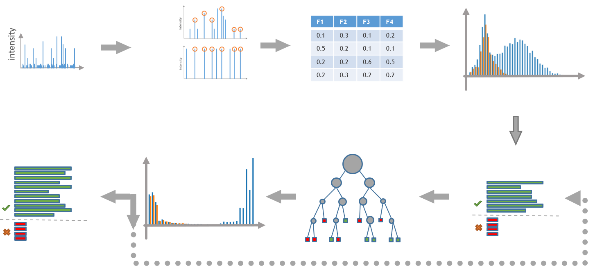

## Tool Description

   [PeptideSpectrumMatching](./peptide-spectrum-matching.md) and [PeptideSpectrumMatchingTIMs](./peptide-spectrum-matching-tims.md) report several target and decoy candidates per spectrum, each with a `SEQUEST-like`, an `Andromeda-like` and an `X!Tandem-like` score. PSMStatistics combines these columns into one score with a `FastTree classifier (ML.NET)` trained to separate targets from decoys. It keeps the best candidate per scan by this score, computes its Q-value and PEP value, and writes the targets that pass both thresholds.

## How does PSMStatistics work?

1. **Build the features**

   The classifier uses one-hot encoded precursor charge, precursor m/z, theoretical mass, absolute mass error, peptide length, and missed cleavages looked up in the peptide database. It also uses the three search scores and their `NormDeltaBestToRest` and `NormDeltaNext` columns. If all rows contain finite `Hyperscore` and `Expectscore`, it includes the hyperscore and −log₁₀ of the expectation value.

2. **Add retention time features**

   With `RetentionTimeFeature`, a per-file FastTree regression with 200 trees and 64 leaves predicts scan time from peptide sequence and modifications. Training uses the best targets per scan with q < 0.01 under the initial score, using the median scan time for each modified sequence and global modification. The predictors include sequence length, amino acid and modification counts, the unordered residue pairs at positions 1 and n−1 and 2 and n−2, and the C-terminal residue. A peptide and its pseudo-reversal stay in the same one of five sequence folds and receive the same prediction. `RtDeviation` is the observed minus predicted scan time divided by 1.4826 times the median absolute deviation of the held-out residuals. `AbsRtDeviation` is its absolute value. If fewer than 500 peptides are available or held-out R² is below 0.3, the classifier proceeds without both features and logs a warning.

3. **Train and refine the scoring model**

   Initial training ranks candidates by −log₁₀(`Expectscore`) when those expectation values are available, or by the SEQUEST-like score otherwise. The best candidate of a scan supplies a positive example if it is a target and has q < 0.001. Decoy candidates from the remaining scans supply negatives. FastTree trains on a random 90% split and logs accuracy, AUC and F1 on the other 10%. It uses one thread, caps leaf outputs at 10, and uses seed 1024 for ML.NET and scan fold assignment.

   The model rescores the candidates and retrains on updated positives. With cross-validation, the retraining cutoff is q < 0.01. Without it, positives need q < `QValueThreshold / 10` and PEP < `PepValueThreshold`. Retraining keeps the previous model if the count of passing scans falls or training fails. If the count increases by less than `MinimumIncreaseBetweenIterations`, it keeps the new model and stops. The `MaxIterations` limit applies per fold when cross-validation is enabled.

4. **Score held-out scans**

   By default, PSMStatistics shuffles scans into three nearly equal folds. For each fold, it trains on the other two and scores the held-out scans. It scales each fold so the lowest-scoring target with q ≤ 0.01 has a score of 0 and the median decoy has a score of −1. It then pools the rescaled scores. With `CrossValidation = false`, a single model trains on and scores all scans.

5. **Estimate q-values and PEPs**

   For the best candidate per scan, the [q-value](https://www.biofsharp.com/BioFSharp.Mz/04_01_fdr_control.html#Computing-q-values-by-counting-decoys) comes from the cumulative ratio of decoys to targets at or above the score, made monotone (`FDRControl.calculateQValueStorey` of BioFSharp.Mz, without a π0 estimate). For the [posterior error probability (PEP)](https://www.biofsharp.com/BioFSharp.Mz/04_01_fdr_control.html#From-list-level-q-to-single-PSM-PEP), the tool bins the scores and fits a smoothing spline to the logit of the decoy share using iteratively reweighted least squares. Bin width is one FastTree score unit, converted to the pooled scale when cross-validation is enabled. PEP is the fitted decoy-to-target ratio at the candidate's score, capped at 1 and made non-increasing as scores rise.

   A scan is written only if its best candidate is a target and passes both thresholds. When no candidate passes or score estimation fails, the file contains only the header. For an estimation error, see `<run>_log.txt`. To bypass model training, use `Threshold.Fixed` with SEQUEST and Andromeda cutoffs.



## Inputs

These inputs are needed to execute the tool:

| Flag | Meaning | Comes from |
| --- | --- | --- |
| `-i` | one or more `.psm` files, or a directory that is searched for `*.psm` (not recursive) | [PeptideSpectrumMatching](./peptide-spectrum-matching.md) or [PeptideSpectrumMatchingTIMs](./peptide-spectrum-matching-tims.md) |
| `-d` | SQLite peptide database. Updated when `StoreIsotopePatterns` is enabled. | [PeptideDB](./peptide-db.md) |
| `-o` | the output directory, created when missing | - |
| `-p` | the parameter file in JSON | [pSMStatisticsParams.json](https://github.com/CSBiology/ProteomIQon/blob/main/src/ProteomIQon/defaultParams/pSMStatisticsParams.json) |
| `-dc` | switch: save diagnostic charts to the output directory |  |
| `-c` | number of files scored at the same time and the number of cores used to compute the isotope patterns, default 1 | - |

The tool expects the 28-column `.psm` layout. Regenerate files that use the older 23-column layout.

- For every input `run.psm` the tool writes `run.qpsm` to the output directory.
- The file is tab separated with a header and holds one row per scan that passes filtering. [ProteinInference](./protein-inference.md), [PSMBasedQuantification](./psm-based-quantification.md) and [PSMBasedQuantificationTIMs](./psm-based-quantification-tims.md) read these files.
- With `StoreIsotopePatterns` enabled, the tool adds the isotope patterns to the database after scoring the last file. For an isotopically labeled database, it stores both forms of each peptide ion. Quantification reuses patterns written with matching BioFSharp and BioFSharp.Mz versions and computes missing patterns on demand. A write failure produces a warning. On a shared filesystem with unreliable locking, run only one process per database or disable `StoreIsotopePatterns` to avoid concurrent database writes.
- With `-dc`, the per-run `<run>_plots` directory receives `InitialSeparation.html` for the starting scores, `Metrics.html` for the last model's test split, and `separationAtIteration_<n>.html` for model-score distributions, q-values and PEPs. Iterations are numbered from zero. The first retraining replaces the initial model's iteration-zero chart. Cross-validation prefixes the charts with `Fold1_` through `Fold3_` and shows the two training folds for each model. `Threshold.Fixed` produces no charts.
- The tool also creates a `run_plots` directory per input. It stays empty unless you pass `-dc`. Log output goes to `PSMStatistics_log.txt` and `run_log.txt` in the output directory.

## Parameter file

PSMStatistics can either estimate a combined score using iterative learning or apply fixed score cutoffs. The default uses `Threshold.Estimate`.

| Parameter | Default | Description |
|-----------|---------|---------|
| `Threshold` | `Threshold.Estimate estimationParams` | Learn the combined score and filter by q-value and PEP value. The nested record is listed below. |
| `Threshold` (alternative) | `Threshold.Fixed { SequestLike = 0.; Andromeda = 0. }` | Skip the learning. Among the matches whose `SequestScore` exceeds `SequestLike` and whose `AndroScore` exceeds `Andromeda`, keep the one with the highest `SequestScore` per scan, and drop it when it is a decoy. `ModelScore` holds the `SequestScore`, and `QValue` and `PEPValue` are `NaN`. Pick your own cutoffs; these values are placeholders. |
| `ParseProteinIDRegexPattern` | `"id"` | Regex applied to the protein names of the database to produce the `ProteinNames` column. `"id"` keeps them unchanged. The database holds the names as PeptideDB cut them, so keep `"id"`. Another pattern is applied to those stored names and keeps the matched part (empty when it does not match). |
| `KeepTemporaryFiles` | `true` | Not used by PSMStatistics. |
| `StoreIsotopePatterns` | `true` | Store the theoretical isotope patterns of the ions in the `.qpsm` files in the table `IsotopePattern` of the peptide database (`-d`), where the quantification tools read them. |

The fields of `Threshold.Estimate`:

| Parameter | Default | Description |
|-----------|---------|---------|
| `QValueThreshold` | `0.01` | Write PSMs with a q-value below this value. Without `CrossValidation`, the positives of each retraining are the targets with a q-value below a tenth of this value and a PEP below `PepValueThreshold`. |
| `PepValueThreshold` | `1.0` | Write PSMs with a PEP below this value. The default removes only PSMs with a PEP of 1. |
| `MaxIterations` | `15` | Upper limit for the retrainings after the first model, per fold with `CrossValidation`. |
| `MinimumIncreaseBetweenIterations` | `0.005` | Stop when a retraining raises the number of passing scans by less than this fraction of the new number. With `CrossValidation` this number counts the targets with q <= 0.01. Without it, it is the smaller of the numbers of best candidates per scan with q <= `QValueThreshold` and with PEP <= `PepValueThreshold`. |
| `PepValueFittingMethod` | `PepValueFittingMethod.IRLS` | How the PEP curve is fitted. `IRLS` (iteratively reweighted least squares) is the only case. |
| `CrossValidation` | `true` | Score each scan with the model trained on the other two of three scan folds, and normalize the scores per fold. Each fold retrains on the targets with q < 0.01, independent of `QValueThreshold` and `PepValueThreshold`, which then only filter the output. The training runs three times per file, each time on two thirds of the scans, so a run takes about two to three times as long as without `CrossValidation`. Parameter files without this field use `false`. |
| `RetentionTimeFeature` | `true` | Add the features `RtDeviation` and `AbsRtDeviation`, the deviation of the scan time from the time predicted from the sequence. Parameter files without this field use `false`. |


The default parameter file is [pSMStatisticsParams.json ↗](https://github.com/CSBiology/ProteomIQon/blob/main/src/ProteomIQon/defaultParams/pSMStatisticsParams.json).

## Outputs

The output `.qpsm` file contains 27 columns. The columns are grouped by category below.

### Identification and protein assignment (6)

PSM identifiers, peptide sequences and corresponding proteins

| Column | Description |
| --- | --- |
| `PSMId` | Identifier of the MS/MS spectrum |
| `GlobalMod` | `0` for an unlabeled peptide ion, `1` for a labeled peptide ion |
| `PepSequenceID` | Unique identifier of the unmodified peptide sequence, which points to PeptideDB |
| `ModSequenceID` | Unique identifier of the modified peptide sequence (including PTMs, e.g., methylation), which points to PeptideDB |
| `StringSequence` | Amino Acid sequence (one-letter code) from PeptideDB which matches the psm candidate |
| `ProteinNames` | Protein identifiers from the peptide database, separated by semicolons |

### Spectrum, precursor and peptide properties (8)

Scan details, precursor masses, peptide length and missed cleavages

| Column | Description |
| --- | --- |
| `ScanNr` | Number of the MS2 spectrum within the run |
| `ScanTime` | Retention time (RT) in minutes of the MS/MS scan |
| `Charge` | Precursor ion charge state |
| `PrecursorMZ` | Precursor ion mass-to-charge ratio (m/z) |
| `TheoMass` | Theoretical peptide mass in the spectrum (based on amino acid composition) in Dalton |
| `AbsDeltaMass` | Absolute mass deviation between theoretical and measured mass (mass error) |
| `PeptideLength` | Peptide length in Amino Acid count |
| `MissCleavages` | Number of missed cleavages, looked up in the peptide database |

### SEQUEST scoring (3)

Similarity score and normalized differences between candidates

| Column | Description |
| --- | --- |
| `SequestScore` | SEQUEST-like score |
| `SequestNormDeltaBestToRest` | (Best SEQUEST score of the spectrum − this score) / best score. The top candidate has a value of `0`. |
| `SequestNormDeltaNext` | (This SEQUEST score − next lower score of the spectrum) / best score. |

### Andromeda scoring (3)

Match score and normalized differences between candidates

| Column | Description |
| --- | --- |
| `AndroScore` | Andromeda-like score |
| `AndroNormDeltaBestToRest` | (Best Andromeda score of the spectrum − this score) / best score. The top candidate has a value of `0`. |
| `AndroNormDeltaNext` | (This Andromeda score − next lower score of the spectrum) / best score. |

### X!Tandem scoring (3)

Match score and normalized differences between candidates

| Column | Description |
| --- | --- |
| `XtandemScore` | X!Tandem-like score |
| `XtandemNormDeltaBestToRest` | (Best XTandem score of the spectrum − this score) / best score. The top candidate has a value of `0`. |
| `XtandemNormDeltaNext` | (This XTandem score − next lower score of the spectrum) / best score. |

### Target/decoy and statistical confidence (4)

Model score, FDR and posterior error probability

| Column | Description |
| --- | --- |
| `Label` | `1` for target matches. Decoy matches are excluded from the output. |
| `ModelScore` | Fold-normalized score with `CrossValidation`, raw FastTree score without it, or `SequestScore` with `Threshold.Fixed`. |
| `QValue` | Q-value of `ModelScore`. `NaN` with `Threshold.Fixed`. |
| `PEPValue` | Posterior error probability of `ModelScore`. `NaN` with `Threshold.Fixed`. |

## Parameter generation

From the ProteomIQon repository root, build the library with `dotnet build src/ProteomIQon/ProteomIQon.fsproj -c Release`. Save the following as `generate-params.fsx` in that same directory and run `dotnet fsi generate-params.fsx`. The script writes the JSON file to the system temporary directory.

```fsharp
#r "nuget: Newtonsoft.Json, 13.0.4"
#r "./src/ProteomIQon/bin/Release/net10.0/ProteomIQon.dll"

open ProteomIQon
open ProteomIQon.Domain

let psmStatisticsParams : Dto.PSMStatisticsParams =
    {
        Threshold =
            Threshold.Estimate
                {
                    QValueThreshold                  = 0.01
                    PepValueThreshold                = 1.0
                    MaxIterations                    = 15
                    MinimumIncreaseBetweenIterations = 0.005
                    PepValueFittingMethod            = PepValueFittingMethod.IRLS
                    CrossValidation                  = true
                    RetentionTimeFeature             = true
                }
        ParseProteinIDRegexPattern = "id"
        KeepTemporaryFiles         = true
        StoreIsotopePatterns       = true
    }

// Replace the temp folder with your project folder.
let outputPath = System.IO.Path.Combine(System.IO.Path.GetTempPath(), "pSMStatisticsParams.json")

Json.serializeAndWrite outputPath psmStatisticsParams
```

## Installing and executing the tool

Install PSMStatistics as a .NET tool.

```sh
dotnet tool install --global ProteomIQon.PSMStatistics
```

Score a single run.

```sh
proteomiqon-psmstatistics -i path/to/run.psm -d path/to/database.db -o path/to/output -p path/to/pSMStatisticsParams.json
```

Several runs at once, three of them in parallel:

```sh
proteomiqon-psmstatistics -i path/to/run1.psm path/to/run2.psm path/to/run3.psm -d path/to/database.db -o path/to/output -p path/to/pSMStatisticsParams.json -c 3
proteomiqon-psmstatistics -i path/to/psmFolder -d path/to/database.db -o path/to/output -p path/to/pSMStatisticsParams.json -c 3 -dc
```

List all flags with `proteomiqon-psmstatistics --help`.
